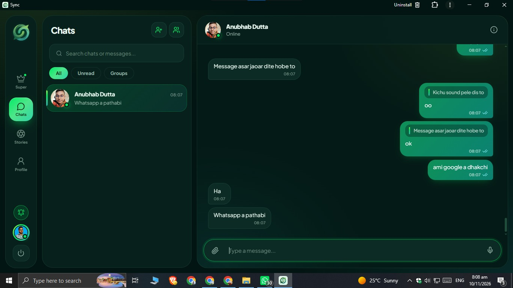
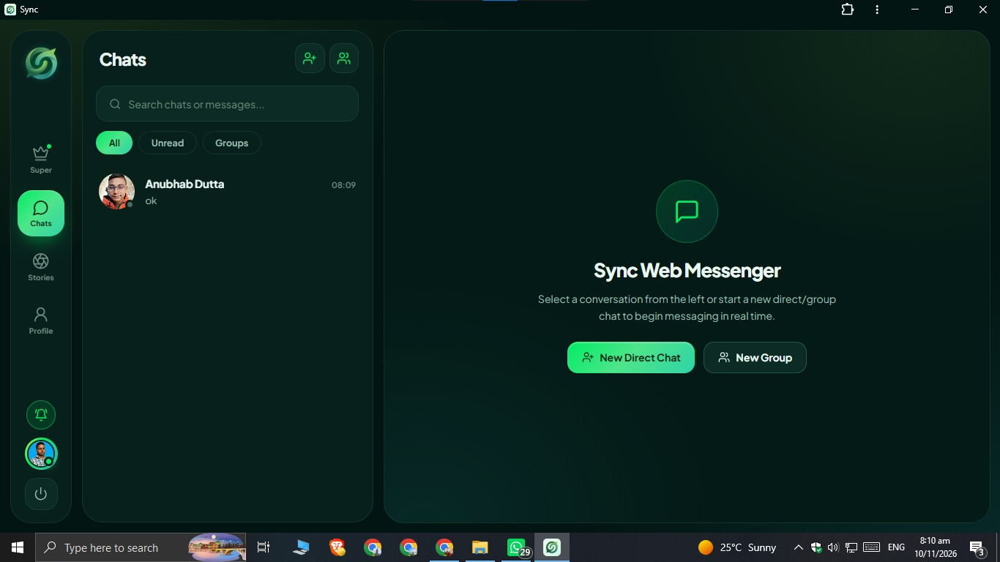
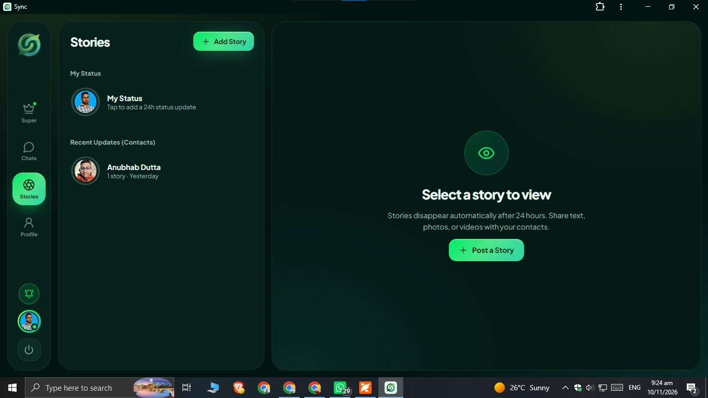
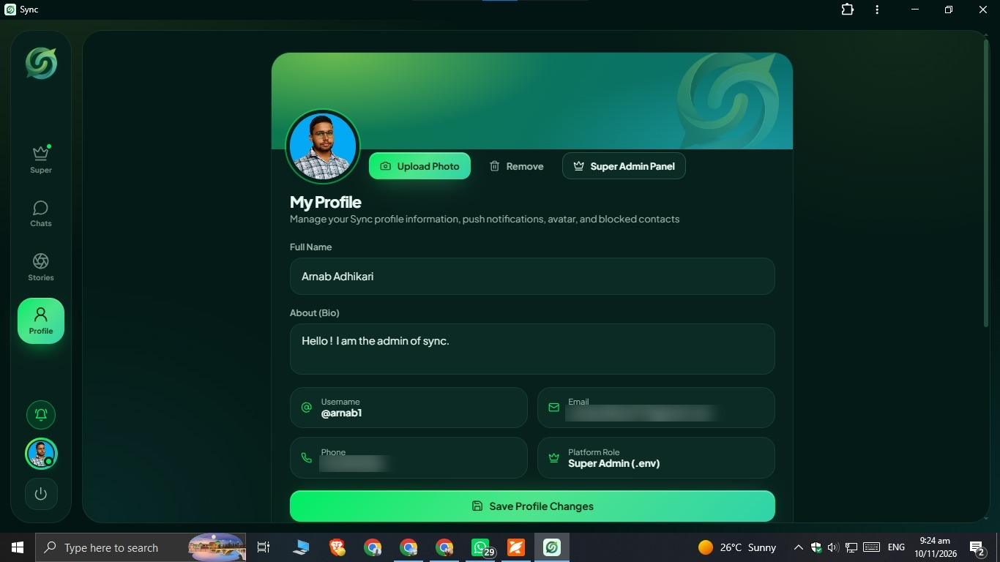
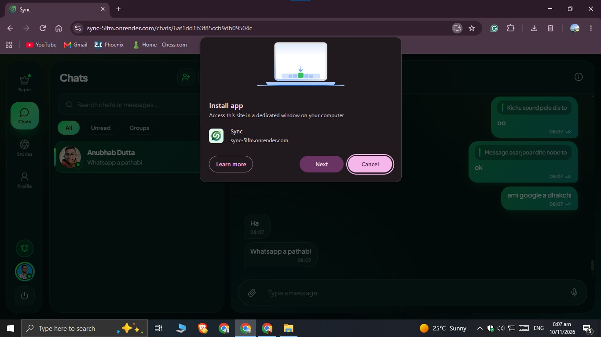
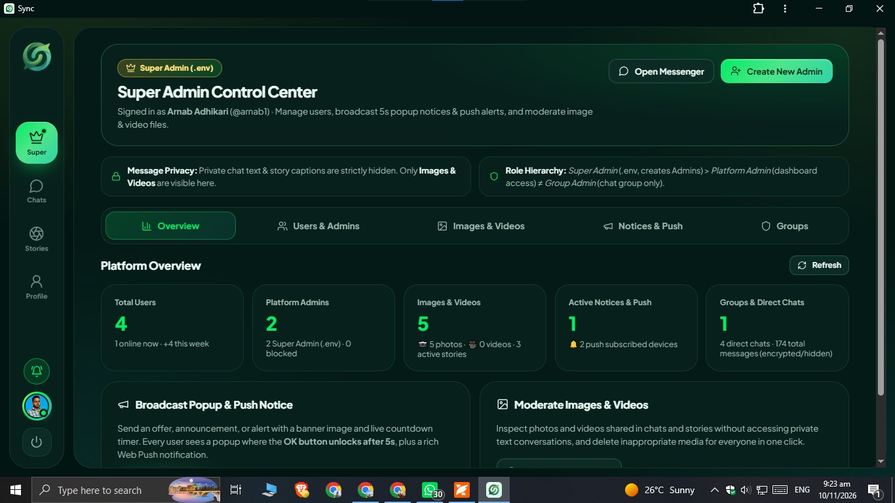
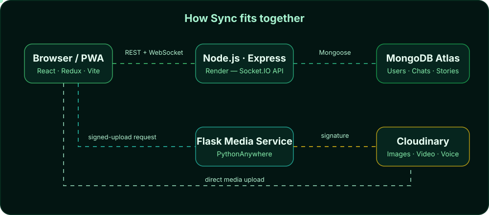
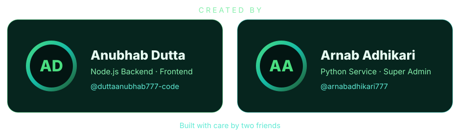

<div align="center">




<p>
  <a href="https://sync-5lfm.onrender.com"></a>
</p>

<p>
  
  
  
  
  
  
  
  
  
</p>

<p><b>Sync</b> is a modern, installable, real-time messenger with private and group chats, 24-hour stories,<br/>web push notifications and a powerful Super Admin control center.</p>

<p>
  <a href="#overview">Overview</a> ·
  <a href="#screenshots">Screenshots</a> ·
  <a href="#features">Features</a> ·
  <a href="#contact">Contact</a> ·
  <a href="#architecture">Architecture</a> ·
  <a href="#getting-started">Getting Started</a> ·
  <a href="#deployment">Deployment</a> ·
  <a href="#team">Team</a>
</p>


</div>

<a id="overview"></a>


Sync is a WhatsApp-style messenger built as a small, deployable monorepo. A single **Node.js** service serves the REST API, the Socket.IO real-time layer and the compiled **React** frontend. A tiny **Flask** service handles signed media uploads, **MongoDB Atlas** stores the data and **Cloudinary** hosts images, videos and voice notes.

The interface uses a dark green theme drawn from the Sync logo, is fully responsive across phone and desktop, and can be installed as a standalone app (PWA).

> [!NOTE]
> The live demo runs on free hosting tiers, so the first request after a period of inactivity can take a few seconds while the server wakes up.

<a id="screenshots"></a>


<div align="center">



<sub><b>Real-time conversations</b> — replies, delivery and read receipts, typing indicators and live presence.</sub>

<br/><br/>

<table>
  <tr>
    <td width="50%" align="center"><br/><sub><b>Chats</b> — search, filters and quick actions</sub></td>
    <td width="50%" align="center"><br/><sub><b>Stories</b> — 24-hour status updates</sub></td>
  </tr>
  <tr>
    <td width="50%" align="center"><br/><sub><b>Profile</b> — avatar, bio and account settings</sub></td>
    <td width="50%" align="center"><br/><sub><b>Installable PWA</b> — runs in its own window</sub></td>
  </tr>
</table>

<br/>



<sub><b>Super Admin control center</b> — platform statistics, user management, media moderation and notices.</sub>

</div>

<a id="features"></a>


### Messaging

- **Direct and group chats** with member management, group icons and leave/remove actions
- **Swipe-to-reply** threads, message deletion and per-message **delivered / seen** receipts
- **Typing indicators** and **live online presence**
- **Rich media:** photos, videos, files and **voice messages** recorded in the browser
- **Chat search** with *All*, *Unread* and *Groups* filters
- **Offline-safe delivery:** client message IDs prevent duplicates and missed messages are re-synced on reconnect
- **Block and unblock** users

### Stories

- Share text, photos or videos as **24-hour stories** that expire automatically (MongoDB TTL index)
- See exactly **who viewed** each story

### Notifications

- **Web Push** (VAPID) alerts that work even when the app is closed
- In-app notification center with read / read-all controls
- **Broadcast notices:** a popup with an optional banner image and a live countdown, where the *OK* button unlocks after 5 seconds, plus a matching push notification

### Super Admin control center

- **Platform overview:** users, admins, media, active notices and conversations at a glance
- **Users and admins:** block, unblock, delete and promote or demote roles
- **Media moderation:** review images and videos from chats and stories and remove inappropriate files for everyone with one click
- **Groups and notices management**
- **Privacy by design:** private chat text and story captions are never shown in the admin panel
- **Role hierarchy:** `Super Admin (.env)` › `Platform Admin` › `Group Admin` (the last applies to a single chat group only)

### Experience

- Smooth animations and a consistent **Sync green gradient** theme
- Responsive layout for phones, tablets and desktops
- **Installable PWA** with a service worker, maskable icons and a clean "Sync" app name

<a id="contact"></a>


The public **Contact Sync** page is available at **[`/contact`](https://sync-5lfm.onrender.com/contact)**. Anyone can submit their name, email address, subject and message without signing in. Submissions are sent through the Email Sender service to the inbox configured for the supplied Email Sender access key.

- The page is public and is not part of the login or registration forms.
- The Email Sender access key is used in the browser, so it is visible to visitors. Use a key intended for public client-side forms, with provider-side restrictions and rate limits where available.
- The contact form includes basic validation, a hidden anti-spam field and a local retry outbox for temporary network failures.
- See [Contact page setup](docs/CONTACT_PAGE_SETUP.md) for the Email Sender configuration.

<a id="architecture"></a>


<div align="center">
  
</div>

| Component | Hosted on | Responsibility |
| --- | --- | --- |
| **Node.js + Express + Socket.IO** | Render | REST API, real-time events, authentication, admin tools, serves `frontend/dist` |
| **React + Redux + Vite** | Served by Node | Chat UI, stories, profile, admin panel, PWA |
| **Flask media service** | PythonAnywhere | Issues short-lived Cloudinary **signed-upload** signatures; never touches the files themselves |
| **MongoDB Atlas** | Atlas | Users, conversations, messages, stories, notices, push subscriptions |
| **Cloudinary** | Cloudinary | Image, video and voice storage |

**How a media upload works:** the browser asks the Flask service for a signature, uploads the file **directly to Cloudinary**, then sends only the resulting URL to the Node.js backend, which validates it and stores the message.

<a id="tech-stack"></a>


| Layer | Technologies |
| --- | --- |
| **Frontend** | React 18, Redux Toolkit, React Router 6, Socket.IO Client, Axios, Lucide icons, Vite 5 |
| **Backend** | Node.js (≥ 20), Express 5, Socket.IO 4, Mongoose, Zod, JWT, bcrypt, Helmet, `web-push` |
| **Media service** | Python, Flask, Cloudinary SDK |
| **Database** | MongoDB Atlas |
| **Hosting** | Render (web service), PythonAnywhere (media service) |

<a id="project-structure"></a>


```text
sync/
├── assets/            # PWA manifest, service workers, icons, logo
├── docs/
│   ├── assets/        # README graphics (animated SVGs, logo)
│   ├── screenshots/   # README screenshots (replace to update)
│   └── DEVELOPMENT_GUIDE.md
├── frontend/          # React + Redux + Vite application
│   └── src/
│       ├── components/  pages/  store/  services/  styles/
├── node-backend/      # Express + Socket.IO API
│   └── src/
│       ├── controllers/  models/  routes/  socket/  services/
│       └── middlewares/  validators/  utils/
├── python-service/    # Flask Cloudinary signature service
├── render.yaml        # Render blueprint
├── API.md             # API contract
└── README.md
```

<a id="getting-started"></a>


### Prerequisites

- Node.js **20.19** or newer
- A MongoDB Atlas connection string
- A Cloudinary account (for media uploads)
- Python 3.10+ (only if you want to run the media service locally)

### Run locally

```bash
# 1. Clone the repository
git clone https://github.com/duttaanubhab777-code/sync.git sync
cd sync

# 2. Install dependencies
npm run install:backend
npm run install:frontend

# 3. Configure the backend
cp node-backend/.env.example node-backend/.env
#    then fill in MONGODB_URI, JWT_SECRET, CLOUDINARY_CLOUD_NAME, ...

# 4. Start the API (http://localhost:5000)
npm run dev:backend

# 5. In a second terminal, start the frontend (http://localhost:5173)
npm run dev:frontend
```

The Vite dev server proxies `/api`, `/health` and `/socket.io` to the backend, so no extra frontend configuration is needed.

### Production build

```bash
npm run build   # installs, builds the frontend and installs backend dependencies
npm start       # serves the API, Socket.IO and the built frontend on one port
```

<a id="configuration"></a>


Create `node-backend/.env` from `.env.example`.

| Variable | Required | Description |
| --- | :---: | --- |
| `MONGODB_URI` | ✅ | MongoDB Atlas connection string |
| `JWT_SECRET` | ✅ | Access-token secret. Must be **identical** to `JWT_SECRET` in the Python service |
| `REFRESH_TOKEN_SECRET` | ✅ | Separate secret for refresh tokens |
| `JWT_EXPIRES_IN` | | Access-token lifetime (default `15m`) |
| `REFRESH_TOKEN_EXPIRY` | | Refresh-token lifetime (default `30d`) |
| `CLOUDINARY_CLOUD_NAME` | ✅ | Cloud name used to validate media URLs |
| `PYTHON_SERVICE_URL` | ✅ | Base URL of the Flask media service |
| `SUPER_ADMIN_EMAILS` | ✅ | Comma-separated emails that become **Super Admins** on registration |
| `VAPID_PUBLIC_KEY` / `VAPID_PRIVATE_KEY` | ✅ | Web Push keys — generate with `npx web-push generate-vapid-keys` |
| `VAPID_SUBJECT` | | `mailto:` contact for push |
| `FRONTEND_URL` | | Extra allowed origin when running the frontend separately |
| `NODE_ENV`, `PORT`, `TRUST_PROXY` | | Standard server settings |

> [!IMPORTANT]
> Cloudinary **API key and secret** belong only on the Python service. Never place them in the Node.js service or the frontend.

<a id="deployment"></a>


**Render (Node.js + frontend)** — the included [`render.yaml`](render.yaml) defines the whole service:

- Leave *Root Directory* empty (repository root)
- Build: `npm --prefix frontend install --include=dev && npm --prefix frontend run build && npm --prefix node-backend install`
- Start: `npm --prefix node-backend start`
- Health check: `/health`
- Add the environment variables listed above in the Render dashboard

**PythonAnywhere (media service)** — upload only the contents of `python-service/`, copy `config.example.py` to `config.py`, fill in the values and reload the web app. See the step-by-step [PythonAnywhere deployment guide](PYTHONANYWHERE_DEPLOYMENT_GUIDE.md).

<a id="api"></a>


All endpoints are served from the same origin under `/api`. Authenticate with `Authorization: Bearer <accessToken>` or the session cookie.

| Area | Base path | Highlights |
| --- | --- | --- |
| Auth | `/api/auth` | register, login, refresh, logout, current user |
| Users | `/api/users` | search, public profile, update profile, block / unblock |
| Conversations | `/api/conversations` | direct and group chats, members, read state, message history |
| Stories | `/api/stories` | feed, create, view, viewers, delete |
| Notifications | `/api/notifications` | list, mark read, push subscriptions |
| Notices | `/api/notices` | pending notices and acknowledgement |
| Admin | `/api/admin` | stats, users, roles, media moderation, groups, notices |
| Sync | `/api/sync` | fetch messages missed while offline |

**Socket.IO events:** `message:send`, `message:new`, `message:delete`, `message:deleted`, `message:delivered`, `message:seen`, `typing:start`, `typing:stop`, `presence:snapshot`, `presence:update`.

The complete request and response contract lives in [`API.md`](API.md).

<a id="security"></a>


- Short-lived **JWT access tokens** with rotating **refresh tokens**; up to five active devices per account
- Passwords hashed with **bcrypt**
- Request validation with **Zod** on every write endpoint
- **Rate limiting** on the API and stricter limits on login and registration
- Hardened HTTP headers with **Helmet** and a strict allow-list **CORS** policy on the media service
- Media URLs are accepted only from the project's own **Cloudinary** account
- Admin tools can moderate images and videos but **cannot read private message text**
- Secrets live in environment variables and are excluded through `.gitignore`

<a id="team"></a>


<div align="center">



<table>
  <tr>
    <td align="center"><a href="https://github.com/duttaanubhab777-code"><b>Anubhab Dutta</b></a><br/><sub>Node.js backend · Frontend</sub></td>
    <td align="center"><a href="https://github.com/arnabadhikari777"><b>Arnab Adhikari</b></a><br/><sub>Python service · Super Admin</sub></td>
  </tr>
</table>

<br/>


</div>
