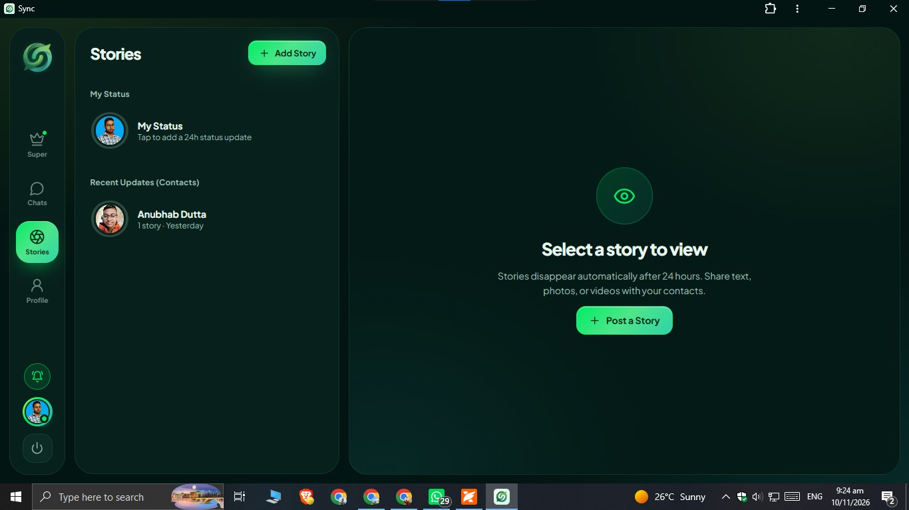
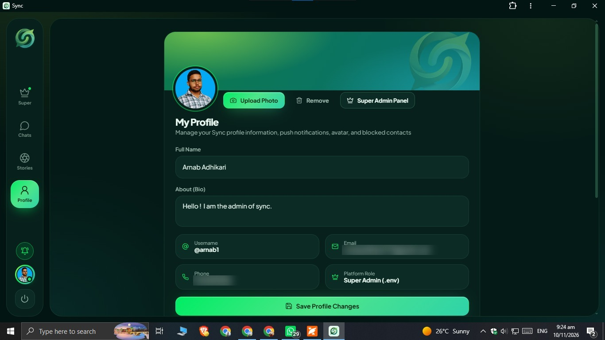
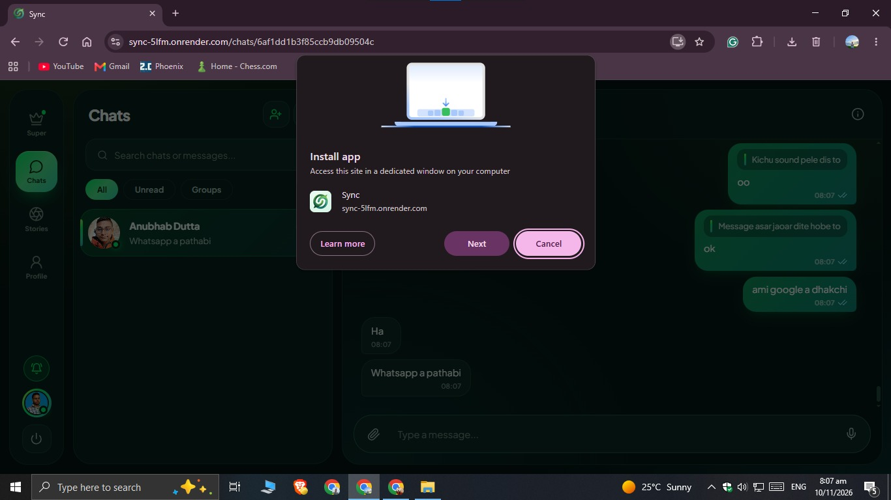
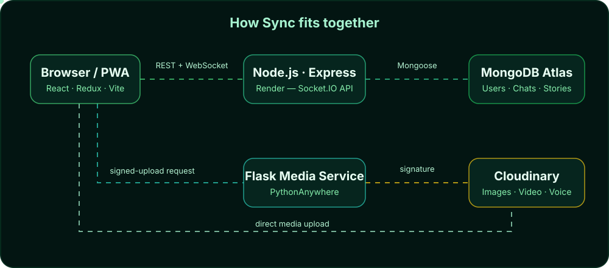

<div align="center">




<p>
  <a href="https://sync-5lfm.onrender.com"></a>
  <a href="https://github.com/duttaanubhab777-code/sync/releases"></a>
</p>

<p>
  
  
  
  
  
  
  
  
  
  
  
  
</p>

<h3>A real-time messaging platform for the web and Android.</h3>
<p>Private and group conversations · Stories · Voice & media · Web Push and Android notifications · Admin workspace</p>

<p>
  <a href="#overview">Overview</a> ·
  <a href="#features">Features</a> ·
  <a href="#architecture">Architecture</a> ·
  <a href="#project-structure">Structure</a> ·
  <a href="#getting-started">Setup</a> ·
  <a href="#configuration">Configuration</a> ·
  <a href="#deployment">Deployment</a> ·
  <a href="#api">API</a> ·
  <a href="#security">Security</a>
</p>


</div>

<a id="overview"></a>


**Sync** is a full-stack, WhatsApp-inspired messaging application built as a deployable monorepo. It combines a React client, an Express REST API, a Socket.IO real-time layer, MongoDB persistence, and a separate Flask service for secure Cloudinary upload signing and signup email delivery.

The Node service serves both the API and the production-built frontend. The Python service is intentionally separate: it signs short-lived media upload parameters and relays OTP emails through Gmail SMTP. Files are uploaded by the browser directly to Cloudinary; neither application server handles the media file bytes.

The interface is responsive and installable as a Progressive Web App. The repository also contains a Capacitor-based Android application, an automated APK release workflow, native push-notification enhancements, and an in-app release/update experience. The Android shell loads the live web application, so most frontend and backend updates do not require a new APK.

> [!NOTE]
> The public web demo uses free hosting tiers. A service may need a short wake-up period after inactivity, and availability depends on the hosting provider.

<a id="screenshots"></a>


<div align="center">


<sub><b>Conversations</b> — live messages, replies, delivery states, typing activity and media.</sub>

<br/><br/>

<table>
  <tr>
    <td width="50%" align="center"><br/><sub><b>Chats</b> — conversation list, search and filters</sub></td>
    <td width="50%" align="center"><br/><sub><b>Stories</b> — 24-hour updates</sub></td>
  </tr>
  <tr>
    <td width="50%" align="center"><br/><sub><b>Profile</b> — account details and settings</sub></td>
    <td width="50%" align="center"><br/><sub><b>Installable PWA</b> — standalone app experience</sub></td>
  </tr>
</table>

<br/>


<sub><b>Administration</b> — platform overview, user and media management.</sub>

</div>

<a id="features"></a>


### Authentication & accounts

- Signup flow with email OTP verification, resend cooldowns, expiry and attempt limits
- Login with username, email address or phone number
- Short-lived access tokens and rotating, per-device refresh sessions
- Secure password hashing, logout and session refresh
- Profile details, avatar and personal status/about text
- Optional profile photo upload during signup, with image preview before account completion
- Automatically suggested usernames based on the email address, live availability checks, and alternative suggestions for taken names
- Block and unblock other users

### Direct & group messaging

- One-to-one conversations and multi-member group chats
- Real-time message delivery with Socket.IO
- Text, image, video, audio/voice and general file attachments
- A dedicated attachment sheet with Gallery, Camera, Video, Document and Audio pickers
- Share the current location with an OpenStreetMap preview and links to Google Maps or OpenStreetMap
- Share contact cards through the browser Contact Picker where supported, with a manual-entry fallback; recipients can copy or call shared numbers
- Document cards preserve filenames, show file types and sizes, and provide direct downloads
- Select and send multiple files sequentially, with per-file upload progress, speed/ETA feedback and independent failure handling
- Browser voice recording with pause/resume, waveform feedback and playback
- Swipe-to-reply and quoted message context
- Sent, delivered and seen states, including group delivery/read information
- Typing and voice-recording activity indicators
- Online presence and last-seen information
- Message deletion and group-level controls
- Group name, description and icon management
- Group member add/remove, admin promotion/demotion, leave-group flow and optional admin-only messaging
- Chat search, unread and group filters
- Optimistic sending, client message IDs, offline pending queue and reconnect synchronization
- Paginated message history and recovery of messages/updates missed while disconnected
- Link detection with server-fetched link preview cards

### Stories

- Text, image and video stories
- Automatic 24-hour expiry using a MongoDB TTL index
- Story feed grouped by author, with unseen stories prioritized
- View counts and a viewer list with viewing times
- Emoji reactions, reaction summaries and live reaction updates
- Reply to a story directly into the relevant conversation
- Duplicate-submission protection for story creation

### Notifications

- In-app notification center with individual and mark-all-as-read actions
- Browser/PWA Web Push notifications using VAPID
- Android native push notifications using Firebase Cloud Messaging (FCM HTTP v1)
- Device subscriptions stored per user; expired endpoints/tokens are cleaned up
- Notification permission/enable flow in the client
- Rich Android notifications with sender avatars, grouped message stacks, group-sender context, image previews and deep links to the relevant conversation
- Dedicated Sync notification tones for messages and notices on supported Android devices
- Unread-count badges on supported Android launchers and PWAs, with a browser-tab title count fallback; badges clear when messages are read or the user signs out
- Real-time updates for messages, stories, notices and account-role changes

### Admin workspace

- Platform statistics and dashboard overview
- User listing, blocking/unblocking and account removal
- Platform admin creation and role management (Super Admin only)
- Group listing and administrative group deletion
- Chat/story media review and moderation
- Broadcast notices with optional banner media and expiry/countdown information
- Real-time notice delivery and acknowledgement tracking
- Role hierarchy: **Super Admin** → **Platform Admin** → **Group Admin** (group-scoped permissions)
- Private chat text and story captions are not exposed in the admin media moderation view

### Contact, updates & app experience

- Public Contact page at [`/contact`](https://sync-5lfm.onrender.com/contact), with validation, anti-spam field and retry outbox
- Contact form integration with the separate Email Sender service
- Android release lookup from GitHub Releases, latest APK download and release history
- In-app update popup and dedicated Updates page
- Responsive layouts for mobile, tablet and desktop, including a mobile-friendly floating chat action button
- PWA manifest, service worker, app icons, install support and unread app-badge integration
- A native Android app built with Capacitor that loads the live Sync web application
- Branded animated splash screens and an offline/retry experience for unavailable networks or a sleeping web service
- Android notification channels with custom Sync sounds, native badge support and notification-to-chat navigation
- Sound feedback, animated interface elements and consistent Sync branding

<a id="contact"></a>


The public Contact page allows visitors to submit a name, email address, subject and message without signing in. The form sends submissions to the separately hosted Email Sender service.

- The Email Sender access key is a public client-side credential in this integration. Use a key intended for browser forms and apply provider-side restrictions/rate limits.
- The contact form is separate from signup OTP delivery. Signup OTP email is sent server-to-server through the Python mail relay.
- Setup notes: [Contact page setup](docs/CONTACT_PAGE_SETUP.md).

### Documentation

- [API reference](docs/API.md)
- [Contact page configuration](docs/CONTACT_PAGE_SETUP.md)
- [Signup OTP and mail-relay setup](docs/OTP_AND_MAIL_RELAY_SETUP_GUIDE.md)
- [PythonAnywhere deployment guide](docs/PYTHONANYWHERE_DEPLOYMENT_GUIDE.md)
- [Python service README](python-service/README.md)
- [Screenshot asset guidelines](docs/screenshots/README.md)

<a id="architecture"></a>


<div align="center">
  
</div>

| Component | Deployment | Responsibility |
| --- | --- | --- |
| React + Redux Toolkit + Vite | Built and served by Node service | UI, routing, state management, media upload client, PWA |
| Node.js + Express | Render Web Service | REST API, authentication, validation, admin operations, static frontend hosting |
| Socket.IO | Same Node HTTP server | Authenticated real-time messaging, presence, typing, read/delivery state and live events |
| MongoDB Atlas + Mongoose | MongoDB Atlas | Users, sessions, conversations, messages, stories, notices, notifications and device subscriptions |
| Flask media/mail service | PythonAnywhere | JWT-verified Cloudinary upload signatures and protected signup OTP mail relay |
| Cloudinary | Cloudinary | Uploaded chat media, voice notes, avatars, stories, group icons and notice banners |
| Firebase Cloud Messaging | Firebase | Native Android push delivery |
| Web Push (VAPID) | Browser push services | Browser and installed-PWA notifications |
| Capacitor Android shell | Android app | Native app container, geolocation integration, push notification handling, launcher badges and app lifecycle integration |
| GitHub Actions | GitHub Actions | Automated Android APK builds and GitHub Release publishing |
| GitHub Releases | GitHub | Android APK release metadata, changelogs and downloads |

### Media upload flow

1. The authenticated browser requests a signature from the Flask service at `/api/v1/media/sign`.
2. Flask verifies the Node-issued access token and validates the requested upload purpose.
3. Flask signs the Cloudinary upload parameters locally and returns the short-lived signature.
4. The browser uploads the file directly to Cloudinary and reports upload progress.
5. The browser sends the resulting media metadata/URL to the Node API or Socket.IO layer.
6. Node validates that the media URL belongs to the configured Cloudinary account before storing the message/story.

The Python service does **not** receive or proxy the uploaded file.

### Signup email flow

1. The Node API creates a pending signup and generates an OTP.
2. Node calls the protected Python mail relay using `MAIL_RELAY_SECRET`.
3. Python sends the OTP email through the configured Gmail SMTP account.
4. The user verifies the OTP; the pending signup is consumed before the account is created.

<a id="tech-stack"></a>


| Layer | Technologies |
| --- | --- |
| Frontend | React 18, Redux Toolkit, React Router 6, Axios, Socket.IO Client, Lucide React, Vite 5 |
| Backend | Node.js, Express 5, Socket.IO 4, Mongoose, MongoDB, Zod, JWT, bcrypt, Helmet, CORS, express-rate-limit, web-push |
| Python service | Python 3.10+, Flask, PyJWT, Cloudinary Python SDK, Gmail SMTP |
| Database | MongoDB Atlas |
| Media storage | Cloudinary |
| Browser notifications | Web Push / VAPID |
| Android notifications | Firebase Cloud Messaging HTTP v1, Capacitor Push Notifications and native Android notification channels |
| Android runtime | Capacitor 7, Android native Java integration and Geolocation plugin |
| Hosting | Render, PythonAnywhere |
| Android distribution | GitHub Releases |

<a id="project-structure"></a>


```text
sync/
├── .github/
│   └── workflows/
│       └── android-apk.yml       # Android APK build/release workflow
├── assets/
│   ├── icons/                    # PWA and app icons
│   ├── manifest.webmanifest
│   └── service-worker.js, sw.js
├── docs/
│   ├── assets/                   # README banner, headers and diagrams
│   ├── screenshots/
│   ├── API.md
│   ├── CONTACT_PAGE_SETUP.md
│   ├── OTP_AND_MAIL_RELAY_SETUP_GUIDE.md
│   └── PYTHONANYWHERE_DEPLOYMENT_GUIDE.md
├── frontend/
│   └── src/
│       ├── components/           # Layout, dialogs, media players, notifications
│       │   └── chat/             # Attachment sheet, location, contact and document cards
│       ├── hooks/                # App badge, sign-out and shared UI hooks
│       ├── pages/                # Auth, chats, stories, profile, admin, contact, updates
│       ├── services/             # API, Socket.IO, media, previews, sounds, app badges, contact mail
│       ├── store/                # Redux Toolkit slices
│       ├── styles/
│       └── utils/
├── node-backend/
│   └── src/
│       ├── controllers/
│       ├── db/
│       ├── middlewares/
│       ├── models/
│       ├── routes/
│       ├── services/
│       ├── socket/
│       │   └── handlers/
│       ├── utils/
│       └── validators/
├── python-service/
│   ├── routes/                   # Health, media signing and mail relay
│   ├── services/                 # Cloudinary signing and SMTP delivery
│   ├── tests/
│   ├── app.py
│   ├── config.example.py
│   └── requirements.txt
├── mobile/                       # Capacitor Android wrapper and native build scripts
│   ├── assets/sounds/            # Custom Android notification tones
│   ├── scripts/                  # Android permissions, icons, badges and notification setup
│   ├── www/                      # Local fallback and offline screens
│   └── capacitor.config.json
├── package.json                  # Root monorepo scripts
├── render.yaml                   # Render Blueprint
└── README.md
```

<a id="getting-started"></a>


### Prerequisites

- Node.js **20.19+** and npm
- MongoDB Atlas database (or a compatible MongoDB instance)
- Python **3.10+** and pip (for the Flask service)
- Cloudinary account for media uploads
- Gmail account with an App Password for signup OTP email (when testing the mail relay)

### 1. Clone the repository

```bash
git clone https://github.com/duttaanubhab777-code/sync.git
cd sync
```

### 2. Install Node dependencies

From the repository root:

```bash
npm run install:backend
npm run install:frontend
```

### 3. Configure the Node backend

Create the backend environment file:

```bash
cp node-backend/.env.example node-backend/.env
```

Fill in the required values described in [Configuration](#configuration). For a local frontend dev server, set `FRONTEND_URL=http://localhost:5173`.

### 4. Start the Node backend and frontend

Open two terminals from the repository root.

Terminal 1:

```bash
npm run dev:backend
```

Terminal 2:

```bash
npm run dev:frontend
```

The API defaults to port `5000` in the example environment. Vite proxies API, health and Socket.IO requests to the backend; check the Vite configuration if you change the backend port.

### 5. Configure and run the Python service

```bash
cd python-service
python -m venv .venv
```

Activate the virtual environment, then install dependencies:

```bash
# Windows
.venv\Scripts\activate

# macOS / Linux
source .venv/bin/activate

pip install -r requirements.txt
```

Create a local `config.py` from `config.example.py` and fill in the values. Keep `JWT_SECRET` identical to the Node backend's `JWT_SECRET`.

Run locally:

```bash
python app.py
```

The Flask service listens on `http://127.0.0.1:5001` by default. Set `PYTHON_SERVICE_URL` in the Node backend to the service URL and add the local frontend origin to Python's `ALLOWED_ORIGINS`.

<a id="configuration"></a>


Use `node-backend/.env.example` as the source of truth for Node environment variable names, and `python-service/config.example.py` / Python settings for the Flask service. Never commit real credentials.

### Node backend — `node-backend/.env`

| Variable | Required | Purpose |
| --- | :---: | --- |
| `MONGODB_URI` | Yes | MongoDB connection string |
| `JWT_SECRET` | Yes | Access-token signing secret; must exactly match Python service `JWT_SECRET` |
| `REFRESH_TOKEN_SECRET` | Recommended | Separate refresh-token signing secret |
| `CLOUDINARY_CLOUD_NAME` | Yes for media | Cloudinary cloud name used to validate media URLs |
| `PYTHON_SERVICE_URL` | Yes for uploads/OTP relay | Base URL of the Flask service |
| `MAIL_RELAY_SECRET` | Yes for OTP email | Shared secret; must match Python `MAIL_RELAY_SECRET` |
| `SUPER_ADMIN_EMAIL` / `SUPER_ADMIN_EMAILS` | Yes to configure Super Admins | Email address(es) granted Super Admin status |
| `VAPID_PUBLIC_KEY` | Optional | Public Web Push application-server key |
| `VAPID_PRIVATE_KEY` | Optional | Private Web Push key; keep secret |
| `VAPID_SUBJECT` | Optional | VAPID contact, usually a `mailto:` value |
| `FIREBASE_SERVICE_ACCOUNT_JSON` | Optional | Firebase service-account JSON for Android FCM |
| `FIREBASE_PROJECT_ID` | Optional | Firebase project ID when using separate credentials |
| `FIREBASE_CLIENT_EMAIL` | Optional | Firebase service-account client email |
| `FIREBASE_PRIVATE_KEY` | Optional | Firebase service-account private key |
| `PORT`, `NODE_ENV`, `TRUST_PROXY` | Optional | Server/runtime settings |
| `FRONTEND_URL` | Optional | Extra allowed frontend origin(s), comma-separated |
| `EMAIL_SENDER_URL` | Optional | Contact-form Email Sender origin; defaults to the configured project service |
| `OTP_SECRET` | Optional | Dedicated secret for OTP hashing |
| `JWT_EXPIRES_IN`, `REFRESH_TOKEN_EXPIRY` | Optional | Access/refresh token lifetimes |

For Firebase, use either the complete service-account JSON in `FIREBASE_SERVICE_ACCOUNT_JSON`, or provide the project ID, client email and private key separately. Do not commit or expose the JSON/private key.

### Python service — `python-service/config.py`

Copy `config.example.py` to `config.py`.

| Setting | Required | Purpose |
| --- | :---: | --- |
| `JWT_SECRET` | Yes | Must exactly match Node `JWT_SECRET` |
| `CLOUDINARY_CLOUD_NAME` | Yes for media | Cloudinary cloud name |
| `CLOUDINARY_API_KEY` | Yes for media | Cloudinary API key |
| `CLOUDINARY_API_SECRET` | Yes for media | Cloudinary API secret; Python service only |
| `ALLOWED_ORIGINS` | Yes | Comma-separated browser origin allow-list |
| `GMAIL_USER` | Yes for OTP mail | Gmail sender address |
| `GMAIL_APP_PASSWORD` | Yes for OTP mail | Google App Password, not the normal account password |
| `MAIL_RELAY_SECRET` | Yes for OTP mail | Must exactly match Node `MAIL_RELAY_SECRET` |
| `MEDIA_FOLDER_ROOT` | Optional | Cloudinary root folder (default: `sync`) |
| `SMTP_MODE` | Optional | `auto`, `465` or `587` |
| `RATE_LIMIT_PER_MINUTE` | Optional | Per-user upload-signing rate limit |

**Credential boundary:** Cloudinary API key/secret and Gmail App Password belong only in the Python service. The Node service needs the Cloudinary cloud name, not the Cloudinary API secret.

<a id="deployment"></a>


### Render — Node API + frontend

The repository includes [`render.yaml`](render.yaml).

- Create a Render Blueprint from this repository.
- Keep the service Root Directory at the repository root.
- The Blueprint installs frontend dependencies, builds `frontend/dist`, installs backend dependencies and starts the Node server.
- Configure the required secrets in the Render Environment tab.
- The Python service health-check endpoint is `/api/v1/health`.
- The service serves the compiled React app and API from the same origin.
- `python-service/**` is excluded from the Node service's auto-deploy build filter; deploy the Python service separately.

### PythonAnywhere — media and mail service

Deploy the contents of `python-service/` as a PythonAnywhere web app, configure the WSGI entry point to import `app` from `app.py`, install `requirements.txt`, create the private `config.py`, and reload the web app.

Set the matching `PYTHON_SERVICE_URL` and `MAIL_RELAY_SECRET` in Render. The Node and Python JWT secrets must be identical.

Detailed instructions: [PythonAnywhere deployment guide](docs/PYTHONANYWHERE_DEPLOYMENT_GUIDE.md) and [OTP & mail relay setup](docs/OTP_AND_MAIL_RELAY_SETUP_GUIDE.md).

### Android APK workflow

The GitHub Actions workflow is located at [`.github/workflows/android-apk.yml`](.github/workflows/android-apk.yml). Android release metadata and APK downloads are read from GitHub Releases by the public app-updates endpoint. See [Releases](https://github.com/duttaanubhab777-code/sync/releases).

<a id="api"></a>


The Node API is mounted under `/api`. Most application endpoints require a valid access token, sent as a Bearer token or supported session cookie.

| Area | Base path | Purpose |
| --- | --- | --- |
| Authentication | `/api/v1/auth` | OTP signup, resend/verify OTP, login, refresh, logout, current user |
| Users | `/api/v1/users` | User search, public profiles, profile updates and block controls |
| Conversations | `/api/v1/conversations` | Direct/group conversations, members, read state and paginated messages |
| Stories | `/api/v1/stories` | Story feed, create, view, viewers, reactions and replies |
| Notifications | `/api/v1/notifications` | In-app notifications, read state, push config and device subscriptions |
| Notices | `/api/v1/notices` | Pending notices and acknowledgement |
| Admin | `/api/v1/admin` | Platform stats, users, roles, media, groups and notices |
| Link previews | `/api/v1/link-preview` | Fetch metadata for a URL |
| App updates | `/api/v1/app/updates` | Public Android release/update metadata |
| Offline sync | `/api/v1/sync` | Recover messages and message updates missed while disconnected |
| Python service health | `/api/v1/health` | Service health and non-secret runtime configuration status |

### Real-time events

Socket.IO is attached to the same HTTP server and authenticates connections using the access token.

| Event | Direction / purpose |
| --- | --- |
| `message:send` | Client → server: send a message |
| `message:new` | Server → recipient(s): new message |
| `message:delete` / `message:deleted` | Delete a message and notify clients |
| `message:delivered` | Client → server: delivery acknowledgement |
| `message:seen` | Client → server: read acknowledgement |
| `message:status_bulk` | Server → clients: updated message status |
| `typing:start` / `typing:stop` | Typing or voice-recording activity |
| `presence:snapshot` / `presence:update` | Online presence and changes |
| `conversation:new` / `conversation:updated` / `conversation:removed` | Live conversation and membership updates |
| `story:new` / `story:deleted` | Story feed changes |
| `story:viewed` / `story:reacted` | Live story views and reactions |
| `notice:new` / `notice:removed` | Broadcast notice changes |
| `user:role_updated` / `user:blocked` | Account permission changes |

The detailed request/response contract is maintained in [`docs/API.md`](docs/API.md).

<a id="security"></a>


- Passwords are hashed with bcrypt.
- Access and refresh tokens use separate signing secrets when configured; refresh tokens are stored as hashes per account/device.
- Signup OTPs are time-limited, attempt-limited and protected by resend/rate limits.
- API write routes use Zod request validation and rate limiting.
- Helmet security headers and a Content Security Policy are configured by the Node server.
- Python media signing verifies the Node-issued JWT, enforces an origin allow-list and applies rate limits.
- The mail relay is server-to-server only, checks a shared secret and applies per-recipient limits.
- Uploaded media is sent directly to Cloudinary; Node validates media URLs against the configured Cloudinary account.
- Admin media moderation does not expose private chat text.
- Secrets and local environment files must remain outside version control.

> [!WARNING]
> Sync is a learning and portfolio project, not a security-audited end-to-end encrypted messenger. Do not treat chat messages as end-to-end encrypted, and do not use the project to store highly sensitive information.

<a id="team"></a>


<div align="center">


<table>
  <tr>
    <td align="center"><a href="https://github.com/duttaanubhab777-code"><b>Anubhab Dutta</b></a><br/><sub>Backend · Frontend · Product development</sub></td>
    <td align="center"><a href="https://github.com/arnabadhikari777"><b>Arnab Adhikari</b></a><br/><sub>Python service · Platform administration</sub></td>
  </tr>
</table>

<br/>


</div>
