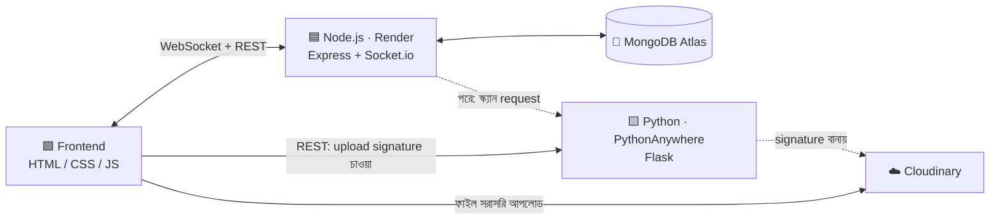
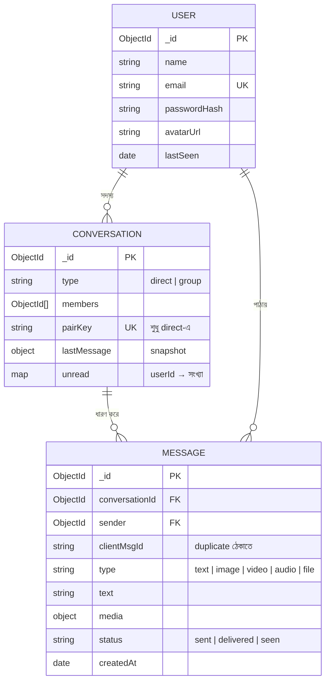
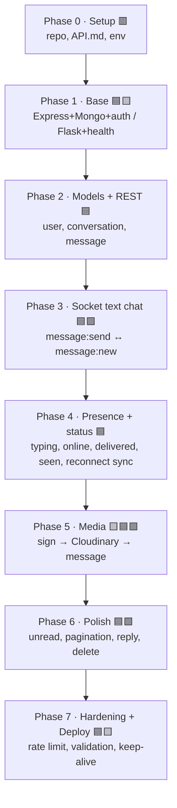
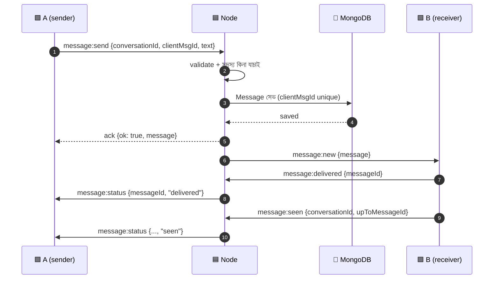
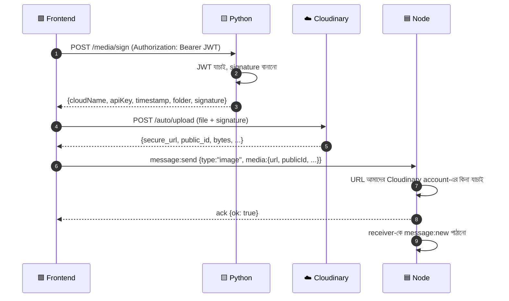
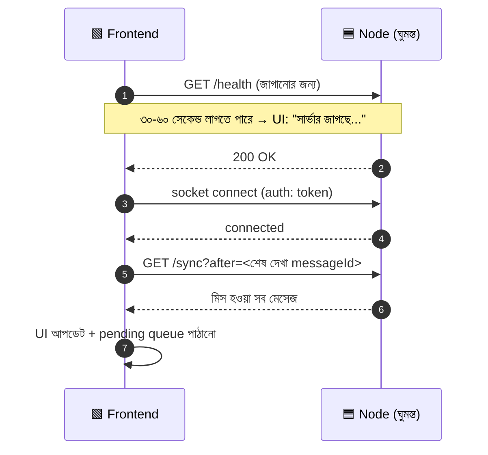

# 💬 Sync

WhatsApp-style real-time chat app, দুই বন্ধু মিলে বানানো।
**Node.js** রিয়েল-টাইম চ্যাট ধরে রাখে, **Python** মিডিয়ার কাজ সামলায়, **MongoDB** ডেটা রাখে, **Cloudinary** ছবি/ভিডিও/ভয়েস রাখে।


---

## 📑 সূচিপত্র

1. [নোটেশন (কে কোনটা করবে)](#-নোটেশন)
2. [আর্কিটেকচার](#-আর্কিটেকচার)
3. [Repo structure](#-repo-structure)
4. [কাজের ভাগ: Node vs Python vs Frontend](#-কাজের-ভাগ)
5. [Frontend কোথায় করব](#-frontend-কোথায়-করব)
6. [Data structure](#-data-structure)
7. [Build order (ধাপে ধাপে)](#-build-order)
8. [Flow diagram](#-flow-diagram)
9. [API contract](#-api-contract)
10. [মূল কোডের নমুনা](#-মূল-কোডের-নমুনা)
11. [সম্ভাব্য সমস্যা ও সমাধান](#-সম্ভাব্য-সমস্যা-ও-সমাধান)
12. [Security checklist](#-security-checklist)
13. [Environment variables](#-environment-variables)
14. [Deploy](#-deploy)
15. [Git workflow](#-git-workflow-দুজনের-জন্য)
16. [Roadmap checklist](#-roadmap-checklist)

---

## 🏷 নোটেশন

পুরো README-তে এই ট্যাগগুলো দেখবে:

| ট্যাগ      | মানে                                                       | কে                           |
| ---------- | ---------------------------------------------------------- | ---------------------------- |
| 🟦 **[N]** | Node.js কাজ (Render)                                       | Jarvis                       |
| 🟨 **[P]** | Python কাজ (PythonAnywhere)                                | বন্ধু                        |
| 🟩 **[F]** | Frontend কাজ                                               | যে ফ্রি থাকে (শুরুতে Jarvis) |
| 🟥 **[C]** | Contract: দুজনে একসাথে ঠিক করতে হবে, `API.md`-তে লিখতে হবে | দুজনেই                       |

Socket event নাম রাখার নিয়ম: `জিনিস:কাজ`, যেমন `message:send`, `typing:start`।

---

## 🏗 আর্কিটেকচার



**মূল সিদ্ধান্ত (কেন এভাবে):**

- **টেক্সট মেসেজ** শুধু Node-এর মধ্য দিয়ে যায়। Python এখানে নেই, তাই চ্যাট দ্রুত।
- **ফাইল** Python-এর মধ্য দিয়ে যায় না। Python শুধু একটা _signed upload signature_ দেয়, আর frontend সরাসরি Cloudinary-তে আপলোড করে। এতে Render-এর RAM আর PythonAnywhere-এর CPU/bandwidth লিমিট কোনোটাই ফাইলের চাপ নেয় না।
- **Python থেকে Node-কে ডাকার দরকার নেই।** PythonAnywhere ফ্রি প্ল্যানে বাইরের সাইটে রিকোয়েস্ট পাঠানো সীমিত (whitelist), তাই ডিজাইন এমন রাখা হয়েছে যাতে Python শুধু _রিকোয়েস্ট রিসিভ_ করে, নিজে বাইরে ডাকে না।
- ফাইল আপলোড শেষ হলে frontend URL-টা Socket.io দিয়ে Node-কে পাঠায়, Node সেটা MongoDB-তে রাখে।

---

## 📁 Repo structure

```
sync/
├── node-backend/            # 🟦 Render
│   ├── src/
│   │   ├── controllers/     # auth, user, conversation, message (HTTP)
│   │   ├── socket/
│   │   │   ├── index.js           # io setup + socket auth
│   │   │   ├── store.js           # userId → সংযুক্ত socket সংখ্যা (presence)
│   │   │   └── handlers/
│   │   │       ├── message.js     # message:send / message:new
│   │   │       ├── presence.js    # online/offline, typing
│   │   │       └── status.js      # delivered / seen
│   │   ├── db/              # MongoDB connection
│   │   ├── middlewares/     # auth (HTTP + socket), rate limit, error
│   │   ├── models/          # user, conversation, message
│   │   ├── routes/
│   │   ├── services/        # business logic (message.service.js ...)
│   │   ├── utils/
│   │   ├── app.js           # Express
│   │   ├── constants.js
│   │   └── index.js         # http server + Socket.io attach
│   └── .env.example
├── python-service/          # 🟨 PythonAnywhere
│   ├── routes/              # /health, /media/sign, (পরে) /scan
│   ├── services/            # cloudinary, scanner
│   ├── utils/               # JWT যাচাই, shared-secret যাচাই
│   ├── app.py
│   ├── config.example.py
│   └── requirements.txt
├── frontend/                # 🟩
├── API.md                   # 🟥 দুজনের চুক্তি
└── README.md
```

---

## 🤝 কাজের ভাগ

### 🟦 Node.js (Render)

- Express সার্ভার, auth (register/login, JWT), Email-Sender-এর কোড থেকে নেওয়া যাবে
- MongoDB মডেল ও ইনডেক্স
- Conversation/Message REST API (ইতিহাস, pagination, sync)
- Socket.io: auth, মেসেজ পাঠানো/রিসিভ, typing, online/offline, delivered/seen
- Reconnect-এর পর মিস হওয়া মেসেজ ফেরত দেওয়া
- মিডিয়া মেসেজ সেভ করার আগে URL যাচাই করা
- `/health` endpoint (cold start জাগাতে)

### 🟨 Python (PythonAnywhere)

- `GET /health`
- `POST /media/sign`: লগইন করা ইউজারকে Cloudinary signed upload signature দেওয়া
- (পরে) `POST /scan`: ছবির NSFW স্ক্যান, Node এই endpoint-কে ডাকবে
- JWT যাচাই (Node-এর দেওয়া token, একই `JWT_SECRET`)
- CORS সেটআপ (`flask-cors`)

### 🟩 Frontend

- Login/Register পেজ, চ্যাট লিস্ট, চ্যাট স্ক্রিন
- Socket সংযোগ, reconnect UI ("সার্ভার জাগছে..."), মেসেজ queue
- মিডিয়া সিলেক্ট → Python থেকে signature → Cloudinary-তে আপলোড → Node-কে URL পাঠানো
- লোকাল cache (`localStorage`/IndexedDB), শেষ দেখা মেসেজ মনে রাখা

---

## 🖥 Frontend কোথায় করব

**সুপারিশ: একই repo-র `frontend/` ফোল্ডারে, আলাদা static হোস্টিংয়ে ডিপ্লয়।**

| অপশন                                                                                                      | ভালো দিক                                                                    | খারাপ দিক                                                   |
| --------------------------------------------------------------------------------------------------------- | --------------------------------------------------------------------------- | ----------------------------------------------------------- |
| **`frontend/` + আলাদা static host** (Vercel / Netlify / Cloudflare Pages, Root Directory = `frontend`) ✅ | পেজ সাথে সাথে লোড হয়, Render ঘুমিয়ে থাকলেও "সার্ভার জাগছে" UI দেখানো যায় | CORS সেটআপ লাগে                                             |
| Node-এর `public/` থেকে serve                                                                              | CORS লাগে না, এক জায়গায় ডিপ্লয়                                           | Render ঘুমালে পেজই খোলে না (cold start ৩০-৬০ সেকেন্ডের মতো) |
| আলাদা repo                                                                                                | ডিপ্লয় পরিষ্কার                                                            | `API.md` সিঙ্ক রাখার ঝামেলা                                 |

- মোবাইলে কোডিং করছ বলে শুরুতে **vanilla HTML/CSS/JS** রাখো, কোনো build tool লাগবে না। Socket.io client CDN থেকে নেওয়া যায়।
- GitHub Pages শুধু root বা `/docs` ফোল্ডার serve করে, তাই `frontend/` সরাসরি দিতে চাইলে Vercel/Netlify/Cloudflare Pages সহজ।
- **কখন শুরু করবে:** Phase 3-এ একটা খুব সাদামাটা টেস্ট পেজ (login + মেসেজ বক্স), আসল ডিজাইন Phase 4-এর পরে।

---

## 🧱 Data structure



### Mongoose schema-র মূল কাঠামো

```js
// models/message.model.js
{
  conversationId: { type: ObjectId, ref: "Conversation", required: true },
  sender:         { type: ObjectId, ref: "User", required: true },
  clientMsgId:    { type: String, required: true },   // frontend-এর বানানো UUID
  type:           { type: String, enum: ["text","image","video","audio","file"], default: "text" },
  text:           { type: String, maxlength: 4000 },
  media: {
    url: String, publicId: String, mime: String,
    bytes: Number, width: Number, height: Number, duration: Number
  },
  status:         { type: String, enum: ["sent","delivered","seen"], default: "sent" },
  hidden:         { type: Boolean, default: false }    // পরে স্ক্যানে ধরা পড়লে
}
// + timestamps: true
```

```js
// models/conversation.model.js
{
  type:    { type: String, enum: ["direct","group"], default: "direct" },
  members: [{ type: ObjectId, ref: "User" }],
  pairKey: { type: String, unique: true, sparse: true }, // sort করা দুই id জুড়ে: "idA_idB"
  lastMessage: { text: String, type: String, sender: ObjectId, createdAt: Date },
  unread:  { type: Map, of: Number, default: {} }
}
```

### ইনডেক্স (না দিলে ধীর হবে বা duplicate ঢুকবে)

```js
messageSchema.index({ conversationId: 1, _id: -1 }); // ইতিহাস + pagination
messageSchema.index({ sender: 1, clientMsgId: 1 }, { unique: true }); // idempotency
conversationSchema.index({ members: 1, updatedAt: -1 }); // চ্যাট লিস্ট
```

### Server memory-তে রাখা জিনিস

```js
// socket/store.js
const online = new Map(); // userId -> সংযুক্ত socket সংখ্যা (একাধিক ট্যাব/ডিভাইসের জন্য)
```

### Socket rooms

- `user:<userId>`: ওই ইউজারের সব ডিভাইস। মেসেজ পাঠানো হয় এখানে।
- `conv:<conversationId>`: typing ও presence এখানে যায়।

---

## 🪜 Build order

ক্রমটা গুরুত্বপূর্ণ: প্রতিটা ধাপ আগেরটার ওপর দাঁড়ায়। একটা ধাপ ঠিকমতো না চললে পরেরটায় যেও না।



| Phase | 🟦 Node                                                                                                     | 🟨 Python                                   | 🟩 Frontend                                  |
| ----- | ----------------------------------------------------------------------------------------------------------- | ------------------------------------------- | -------------------------------------------- |
| **0** | repo push ✅, `API.md`-তে event/endpoint তালিকা                                                             | একই                                         | —                                            |
| **1** | Express, Mongo connect, `/health`, register/login/JWT                                                       | Flask skeleton, `/health`, JWT verify, CORS | —                                            |
| **2** | মডেল + ইনডেক্স, `GET /conversations`, `GET /messages` (pagination), user search, direct conversation বানানো | `/media/sign` লেখা ও টেস্ট (Postman)        | —                                            |
| **3** | Socket auth, `message:send` + ack, `message:new`, idempotency                                               | Cloudinary signature টেস্ট                  | ছোট টেস্ট পেজ (login, মেসেজ পাঠানো/দেখা)     |
| **4** | typing, online/offline, delivered/seen, `GET /sync`                                                         | —                                           | আসল চ্যাট UI, reconnect + "সার্ভার জাগছে" UI |
| **5** | media URL যাচাই + সেভ                                                                                       | `/media/sign` ফাইনাল (size/type নিয়ম)      | মিডিয়া সিলেক্ট, progress bar, preview       |
| **6** | unread count, reply, soft delete                                                                            | (ঐচ্ছিক) `/scan`                            | UI পলিশ                                      |
| **7** | helmet, rate-limit, validation, error handler, logging                                                      | rate-limit, লগ                              | PWA/ইনস্টল (ঐচ্ছিক)                          |

> 💡 **পরামর্শ:** Phase 3-এর শেষে দুজন দুটো আলাদা browser/ফোনে লগইন করে মেসেজ পাঠালে যদি অপর পাশে সাথে সাথে আসে, তাহলে প্রজেক্টের সবচেয়ে কঠিন অংশ পেরিয়ে গেছ।

---

## 🔄 Flow diagram

### ১) টেক্সট মেসেজ



### ২) ছবি/ভিডিও/ভয়েস পাঠানো



### ৩) Render ঘুমিয়ে থাকলে (cold start) ও reconnect



---

## 📡 API contract

> 🟥 এই অংশের বিস্তারিত ও আপডেট থাকবে `API.md`-তে। বদলাতে হলে দুজনেই জানাবে।

### 🟦 Node: REST

| Method | Path                                                   | কাজ                             |
| ------ | ------------------------------------------------------ | ------------------------------- |
| GET    | `/health`                                              | জীবিত কিনা                      |
| POST   | `/api/auth/register`                                   | নতুন ইউজার                      |
| POST   | `/api/auth/login`                                      | JWT দেয়                        |
| GET    | `/api/users?search=`                                   | ইউজার খোঁজা                     |
| GET    | `/api/conversations`                                   | আমার চ্যাট লিস্ট                |
| POST   | `/api/conversations`                                   | direct চ্যাট শুরু (`{userId}`)  |
| GET    | `/api/conversations/:id/messages?before=<id>&limit=30` | ইতিহাস                          |
| GET    | `/api/sync?after=<messageId>`                          | reconnect-এর পর মিস হওয়া মেসেজ |

### 🟦 Node: Socket events

| Event                          | দিক                      | Payload                                              |
| ------------------------------ | ------------------------ | ---------------------------------------------------- |
| `message:send`                 | client → server (ack সহ) | `{conversationId, clientMsgId, type, text?, media?}` |
| `message:new`                  | server → client          | `{message}`                                          |
| `message:delivered`            | client → server          | `{messageId}`                                        |
| `message:seen`                 | client → server          | `{conversationId, upToMessageId}`                    |
| `message:status`               | server → client          | `{messageId, status}`                                |
| `typing:start` / `typing:stop` | client → server          | `{conversationId}`                                   |
| `typing`                       | server → client          | `{conversationId, userId, isTyping}`                 |
| `presence:update`              | server → client          | `{userId, online, lastSeen?}`                        |

Ack-এর আকার সবসময় এক রকম রাখো: `{ ok: true, ... }` অথবা `{ ok: false, error: "CODE" }`।

### 🟨 Python: REST

| Method | Path            | Auth            | কাজ                  |
| ------ | --------------- | --------------- | -------------------- |
| GET    | `/health`       | —               | জীবিত কিনা           |
| POST   | `/media/sign`   | `Bearer JWT`    | Cloudinary signature |
| POST   | `/scan` _(পরে)_ | `X-Service-Key` | ছবি স্ক্যান          |

---

## 💻 মূল কোডের নমুনা

শুধু কাঠামো বোঝার জন্য, পুরো কোড নিজেরা লিখবে।

### 🟦 Socket auth ও connection (`socket/index.js`)

```js
io.use((socket, next) => {
    try {
        const token = socket.handshake.auth?.token;
        socket.user = jwt.verify(token, process.env.JWT_SECRET); // { id }
        next();
    } catch {
        next(new Error("UNAUTHORIZED"));
    }
});

io.on("connection", socket => {
    socket.join(`user:${socket.user.id}`); // এক ইউজারের সব ডিভাইস এক room-এ
    // ইউজারের সব conversation-এর `conv:<id>` room-এও join করাও
    registerMessageHandlers(io, socket);
    registerPresenceHandlers(io, socket);
});
```

### 🟦 মেসেজ পাঠানোর ধাপ (`handlers/message.js`)

```js
socket.on("message:send", async (data, ack) => {
    try {
        // 1) data validate (type, text length, media)
        // 2) socket.user.id এই conversation-এর সদস্য কিনা
        // 3) media থাকলে URL যাচাই (নিচের "Security" দেখো)
        // 4) সেভ করো; (sender, clientMsgId) duplicate হলে আগেরটাই ফেরত দাও
        const msg = await messageService.create({
            senderId: socket.user.id,
            ...data
        });

        ack?.({ ok: true, message: msg });
        io.to(memberRooms)
            .except(socket.id)
            .emit("message:new", { message: msg });
    } catch (e) {
        ack?.({ ok: false, error: e.code || "SERVER_ERROR" });
    }
});
```

### 🟨 Cloudinary signature (`python-service/routes/media.py`)

```python
import time
from cloudinary import utils
from flask import Blueprint, jsonify
from utils.auth import require_jwt
from config import CLOUD_NAME, API_KEY, API_SECRET

bp = Blueprint("media", __name__)

@bp.post("/media/sign")
@require_jwt
def sign():
    params = {"timestamp": int(time.time()), "folder": "sync/chat"}
    signature = utils.api_sign_request(params, API_SECRET)
    return jsonify({**params, "signature": signature,
                    "cloudName": CLOUD_NAME, "apiKey": API_KEY})
```

### 🟩 Frontend: সংযোগ ও reconnect

```js
// সার্ভার জাগানো, তারপর socket
await fetch(`${NODE_URL}/health`).catch(() => {});

const socket = io(NODE_URL, {
    auth: { token },
    transports: ["websocket"],
    reconnectionDelayMax: 5000
});

socket.on("connect", syncMissedMessages); // GET /api/sync?after=lastId
socket.on("disconnect", () => showBanner("সংযোগ বিচ্ছিন্ন..."));
```

### 🟩 Frontend: Cloudinary-তে সরাসরি আপলোড

```js
const s = await (
    await fetch(`${PY_URL}/media/sign`, {
        method: "POST",
        headers: { Authorization: `Bearer ${token}` }
    })
).json();

const fd = new FormData();
fd.append("file", file);
fd.append("api_key", s.apiKey);
fd.append("timestamp", s.timestamp);
fd.append("folder", s.folder);
fd.append("signature", s.signature);

const res = await fetch(
    `https://api.cloudinary.com/v1_1/${s.cloudName}/auto/upload`,
    { method: "POST", body: fd }
);
const media = await res.json(); // secure_url, public_id, bytes ...
```

---

## 🚧 সম্ভাব্য সমস্যা ও সমাধান

| #   | সমস্যা                                         | কেন হয়                                                          | সমাধান                                                                                                                                          |
| --- | ---------------------------------------------- | ---------------------------------------------------------------- | ----------------------------------------------------------------------------------------------------------------------------------------------- |
| 1   | **Render cold start**                          | ফ্রি প্ল্যানে কিছুক্ষণ রিকোয়েস্ট না এলে সার্ভার ঘুমায়          | অ্যাপ খুললেই আগে `/health` ডাকো + "সার্ভার জাগছে" UI। চাইলে UptimeRobot দিয়ে ৫ মিনিট পরপর `/health` ping (Render-এর ফ্রি ঘণ্টার সীমা দেখে নিও) |
| 2   | **Socket কেটে গেলে মেসেজ হারানো**              | সার্ভার রিস্টার্টে memory মুছে যায়                              | Socket.io-র built-in recovery-র ওপর ভরসা করো না। DB-ভিত্তিক `GET /sync?after=` রাখো, `connect` ইভেন্টে সবসময় চালাও                             |
| 3   | **একই মেসেজ দুইবার**                           | নেটওয়ার্ক ফেলে ক্লায়েন্ট আবার পাঠায়                           | ক্লায়েন্ট `clientMsgId` (UUID) বানায়, DB-তে `(sender, clientMsgId)` unique index                                                              |
| 4   | **মেসেজের ক্রম গোলমাল**                        | দুজন একসাথে পাঠায়                                               | ক্রম ঠিক করে সার্ভারের `createdAt` + `_id`, ক্লায়েন্টের সময় নয়। UI-তে optimistic মেসেজ আগে "pending" দেখাও                                   |
| 5   | **অফলাইন ইউজারের মেসেজ**                       | Receiver অনলাইন নেই                                              | মেসেজ আগে DB-তে, socket পরে। সে ফিরে এলে `/sync` দেবে                                                                                           |
| 6   | **একাধিক ট্যাব/ডিভাইস**                        | `userId → socketId` Map এক জায়গায় ওভাররাইট হয়                 | `user:<id>` room ব্যবহার করো। presence-এ socket _গণনা_ রাখো, ০ হলে offline                                                                      |
| 7   | **PythonAnywhere-এর outbound সীমা**            | ফ্রি প্ল্যানে whitelist                                          | ডিজাইনে Python কাউকে ডাকে না। `/media/sign`-এ বাইরে কল লাগে না, শুধু গণনা                                                                       |
| 8   | **PythonAnywhere ফ্রি অ্যাপ বন্ধ হয়ে যাওয়া** | নিয়মিত Web tab-এ "Run until 3 months from today" বাটন চাপতে হয় | ক্যালেন্ডারে রিমাইন্ডার রাখো                                                                                                                    |
| 9   | **CORS error**                                 | Frontend আলাদা domain-এ                                          | Node-এ `cors({origin: [FRONTEND_URL]})` ও Socket.io `cors` অপশন, Flask-এ `flask-cors`। `*` ব্যবহার করো না                                       |
| 10  | **বড় ফাইল**                                   | ভিডিও/ভয়েস                                                      | Frontend-এ আগেই size/type যাচাই, Cloudinary dashboard-এও limit দেখো। Python/Node-এর মধ্য দিয়ে ফাইল না যাওয়ায় সার্ভারের RAM বাঁচে             |
| 11  | **নকল মিডিয়া URL**                            | কেউ যেকোনো URL পাঠিয়ে দিতে পারে                                 | Node যাচাই করবে URL `https://res.cloudinary.com/<CLOUD_NAME>/` দিয়ে শুরু কিনা                                                                  |
| 12  | **XSS**                                        | মেসেজে `<script>`                                                | Frontend-এ সবসময় `textContent`, `innerHTML` নয়                                                                                                |
| 13  | **Spam/flood**                                 | অনেক দ্রুত মেসেজ                                                 | Socket-এ ইউজার প্রতি rate limit (যেমন ১০ সেকেন্ডে ২০টা)                                                                                         |
| 14  | **একাধিক Render instance**                     | Socket state এক instance-এর memory-তে                            | এখন এক instance-ই যথেষ্ট। বাড়াতে হলে Redis adapter + sticky session                                                                            |
| 15  | **একই দুজনের দুটো direct chat**                | race condition                                                   | `pairKey` (sort করা id জোড়া) unique index                                                                                                      |
| 16  | **JWT মেয়াদ শেষ হলে socket কেটে যাওয়া**      | Token expire                                                     | Access token ছোট মেয়াদ + refresh endpoint; reconnect-এর আগে token নবায়ন                                                                       |
| 17  | **Secret leak**                                | `.env`/`config.py` commit                                        | `.gitignore`-এ আছে ✅। ভুল করে commit হলে key সাথে সাথে বদলাও                                                                                   |

---

## 🔐 Security checklist

- [ ] পাসওয়ার্ড `bcrypt` দিয়ে hash
- [ ] `helmet`, `express-rate-limit`
- [ ] Input validation (`zod` বা `joi`) HTTP ও socket দুটোতেই
- [ ] প্রতিটা socket event-এ "এই ইউজার কি conversation-এর সদস্য?" যাচাই
- [ ] CORS allowlist
- [ ] Media URL যাচাই
- [ ] Python → `X-Service-Key` / JWT যাচাই
- [ ] `.env`, `config.py` কখনো commit নয়
- [ ] Error response-এ stack trace নয়

---

## 🔑 Environment variables

**🟦 `node-backend/.env`**

```
PORT=5000
MONGODB_URI=
JWT_SECRET=
JWT_EXPIRES_IN=15m
FRONTEND_URL=
CLOUDINARY_CLOUD_NAME=
PYTHON_SERVICE_URL=
SERVICE_KEY=
```

**🟨 `python-service/config.py`**

```python
JWT_SECRET = ""          # Node-এর সাথে হুবহু এক
CLOUD_NAME = ""
API_KEY = ""
API_SECRET = ""          # শুধু Python-এর কাছে থাকবে
FRONTEND_URL = ""
SERVICE_KEY = ""         # Node-এর সাথে এক
```

> `CLOUDINARY_API_SECRET` শুধু Python-এ থাকবে, Node-এ লাগবে না।

---

## 🚀 Deploy

**🟦 Render**

- Root Directory: `node-backend`
- Build: `npm install` · Start: `node src/index.js`
- Environment-এ উপরের সব ভ্যারিয়েবল
- চাইলে _Build Filter_-এ `node-backend/**` দাও, যাতে Python ফোল্ডারের commit-এ Node রিডিপ্লয় না হয়

**🟨 PythonAnywhere**

```bash
git clone https://github.com/<USERNAME>/sync.git
cd sync/python-service
python3 -m venv venv && source venv/bin/activate
pip install -r requirements.txt
cp config.example.py config.py   # তারপর মান বসাও
```

- Web tab → WSGI ফাইলে `python-service` path দাও
- আপডেটে: `git pull` → Web tab-এ **Reload**

**🟩 Frontend**

- Vercel/Netlify/Cloudflare Pages-এ repo কানেক্ট, Root Directory = `frontend`

---

## 🌿 Git workflow (দুজনের জন্য)

- নিজের ফোল্ডারেই কাজ করো: Jarvis → `node-backend/`, বন্ধু → `python-service/`। এতে conflict প্রায় হয় না।
- `main` সবসময় চলনসই রাখো। নতুন কাজ আলাদা branch-এ: `node/socket-auth`, `python/media-sign`।
- Commit বার্তার ধরন: `feat(node): add message:send handler`, `fix(python): cors origin`
- `API.md` বদলালে commit-এ জানিয়ে দাও, কারণ এটাই দুজনের চুক্তি।
- মার্জের আগে অপর জন একবার দেখে নিলে ভালো (Pull Request)।

---

## ✅ Roadmap checklist

**Phase 0 · Setup**

- [x] Repo বানানো ও structure push
- [ ] 🟥 `API.md`-তে endpoint ও event তালিকা লেখা

**Phase 1 · Base**

- [ ] 🟦 Express + MongoDB connect + `/health`
- [ ] 🟦 Register / Login / JWT
- [ ] 🟨 Flask + `/health` + JWT যাচাই + CORS

**Phase 2 · Models + REST**

- [ ] 🟦 User, Conversation, Message মডেল ও ইনডেক্স
- [ ] 🟦 Conversations ও messages API (pagination)
- [ ] 🟨 `/media/sign` Postman-এ টেস্ট

**Phase 3 · Socket text chat**

- [ ] 🟦 Socket auth + rooms
- [ ] 🟦 `message:send` / `message:new` + ack + idempotency
- [ ] 🟩 টেস্ট পেজে দুই ফোনে চ্যাট

**Phase 4 · Presence + status**

- [ ] 🟦 typing, online/offline
- [ ] 🟦 delivered / seen
- [ ] 🟦 `/sync` + 🟩 reconnect UI

**Phase 5 · Media**

- [ ] 🟩 আপলোড ফ্লো (sign → Cloudinary → message)
- [ ] 🟦 media URL যাচাই
- [ ] 🟩 preview, progress, ভয়েস রেকর্ড

**Phase 6 · Polish**

- [ ] unread count, reply, মেসেজ মুছা, আসল UI

**Phase 7 · Hardening + Deploy**

- [ ] rate limit, validation, error handler
- [ ] Render + PythonAnywhere + Frontend ডিপ্লয়
- [ ] Keep-alive ping

**ভবিষ্যতে**

- [ ] 🟨 NSFW স্ক্যান (`/scan`)
- [ ] গ্রুপ চ্যাট
- [ ] Redis adapter (একাধিক instance)
- [ ] Push notification

---

## 👥 Team

| নাম                                                              | দায়িত্ব                |
| ---------------------------------------------------------------- | ----------------------- |
| [@duttaanubhab777-code](https://github.com/duttaanubhab777-code) | 🟦 Node.js, 🟩 Frontend |
| [@arnabadhikari777](https://github.com/arnabadhikari777)         | 🟨 Python               |

---

<p align="center">Made with ❤️ by two friends</p>
