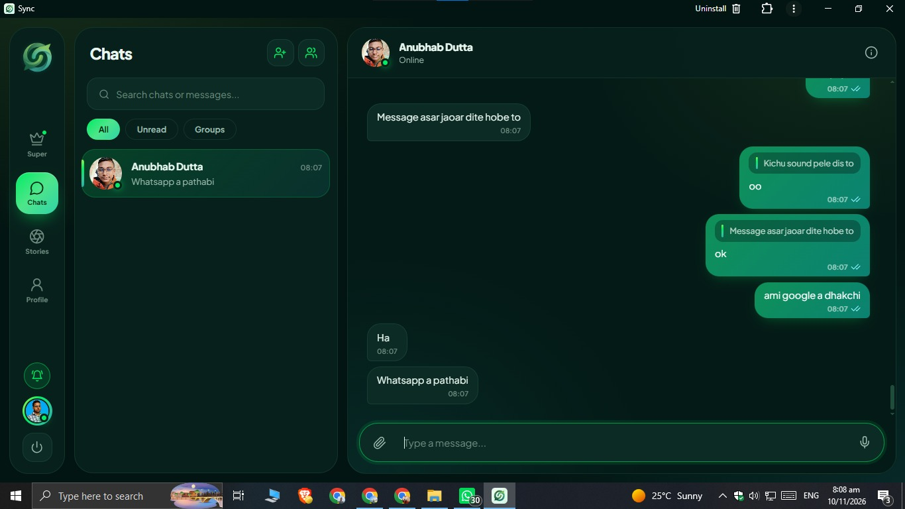
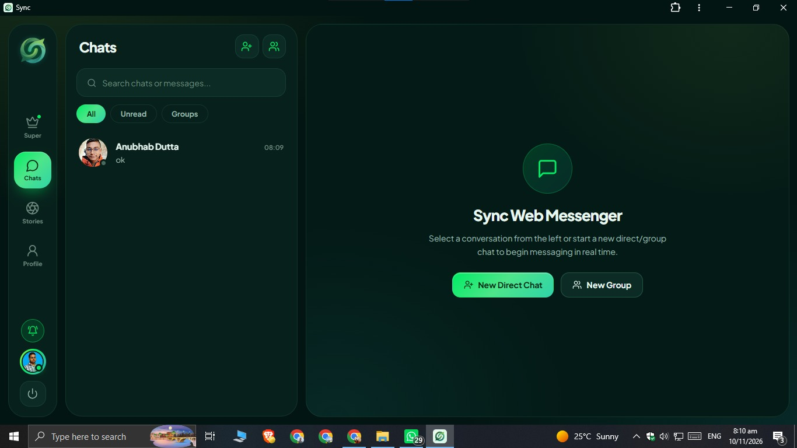
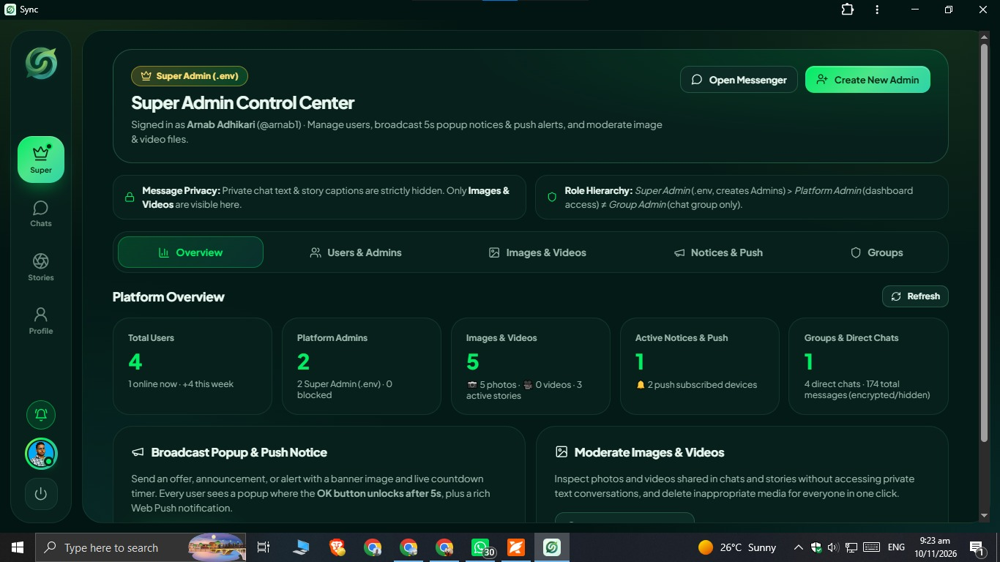
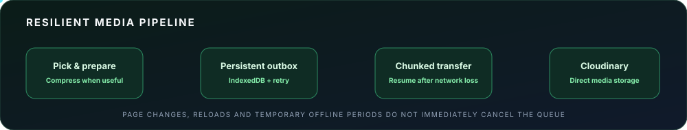
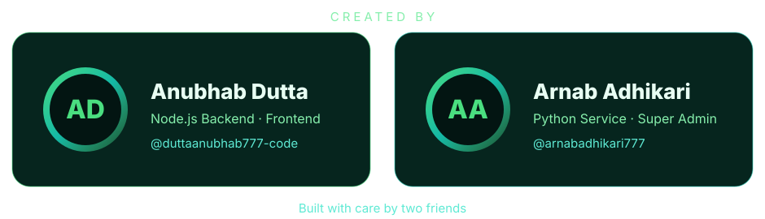

<div align="center">


<p>
  <a href="https://sync-5lfm.onrender.com"></a>
  <a href="https://github.com/duttaanubhab777-code/sync/releases"></a>
</p>

<p>
  
  
  
  
  
  
  
  
  
  
  
  
</p>

<h3>A real-time messaging platform for the web and Android.</h3>
<p>Private and group conversations · Stories · Voice & media · Web Push and Android notifications · Admin workspace</p>

<p>
  <a href="#overview">Overview</a> ·
  <a href="#features">Features</a> ·
  <a href="#architecture">Architecture</a> ·
  <a href="#project-structure">Structure</a> ·
  <a href="#getting-started">Setup</a> ·
  <a href="#configuration">Configuration</a> ·
  <a href="#deployment">Deployment</a> ·
  <a href="#api">API</a> ·
  <a href="#security">Security</a>
</p>


</div>

<a id="overview"></a>


**Sync** is a full-stack, WhatsApp-inspired messaging application built as a deployable monorepo. It combines a React client, an Express REST API, a Socket.IO real-time layer, MongoDB persistence, and a separate Flask service for secure Cloudinary upload signing and signup email delivery.

The Node service serves both the API and the production-built frontend. The Python service is intentionally separate: it signs short-lived media upload parameters and relays OTP emails through Gmail SMTP. Files are uploaded by the browser directly to Cloudinary; neither application server handles the media file bytes.

The interface is responsive and installable as a Progressive Web App. The repository also contains a Capacitor-based Android application, an automated APK release workflow, native push-notification enhancements, and an in-app release/update experience. The Android shell loads the live web application, so most frontend and backend updates do not require a new APK.

> [!NOTE]
> The public web demo uses free hosting tiers. A service may need a short wake-up period after inactivity, and availability depends on the hosting provider.

<a id="screenshots"></a>


<div align="center">



<sub><b>Conversations</b> — live messages, replies, delivery states, typing activity and media.</sub>

<br/><br/>

<table>
  <tr>
    <td width="50%" align="center"><br/><sub><b>Chats</b> — conversation list, search and filters</sub></td>
    <td width="50%" align="center"><br/><sub><b>Stories</b> — 24-hour updates</sub></td>
  </tr>
  <tr>
    <td width="50%" align="center"><br/><sub><b>Profile</b> — account details and settings</sub></td>
    <td width="50%" align="center"><br/><sub><b>Installable PWA</b> — standalone app experience</sub></td>
  </tr>
</table>

<br/>



<sub><b>Administration</b> — platform overview, user and media management.</sub>

</div>

<a id="motion-showcase"></a>


<div align="center">




<sub>Lightweight SVG motion — no JavaScript, external animation runtime or video embed required.</sub>

</div>

<a id="features"></a>


### Authentication & accounts

- Signup flow with email OTP verification, resend cooldowns, expiry and attempt limits
- Login with username, email address or phone number
- Short-lived access tokens and rotating, per-device refresh sessions
- Secure password hashing, logout and session refresh
- Profile details, avatar and personal status/about text
- Optional profile photo upload during signup, with image preview before account completion
- Automatically suggested usernames based on the email address, live availability checks, and alternative suggestions for taken names
- Block and unblock other users
- Forgot-password flow with email OTP, expiry, resend cooldown and attempt limits; responses do not reveal whether an email address has an account
- Change Password from the profile after verifying the current password; password changes revoke other device sessions and invalidate older access tokens

### Contacts & user discovery

- Find people already using Sync from the device address book through the native Capacitor Contacts plugin on Android
- On supported browsers, use the browser Contact Picker so the user explicitly chooses which contacts to share for matching
- Normalize supported Indian phone-number formats and send numbers to the authenticated contact-match endpoint in bounded batches
- Show matched users with their local contact names where available, with refresh and permission-retry states
- Contact matching excludes the signed-in user, blocked users and users who have blocked them; it does not return email addresses
- Full phone and email details are only returned in a profile context when a direct conversation already exists between the two users

### Direct & group messaging

- One-to-one conversations and multi-member group chats
- Real-time message delivery with Socket.IO
- Text, image, video, audio/voice and general file attachments
- A dedicated attachment sheet with Gallery, Camera, Video, Document and Audio pickers
- Share the current location with an OpenStreetMap preview and links to Google Maps or OpenStreetMap
- Share contact cards through the browser Contact Picker where supported, with a manual-entry fallback; recipients can copy or call shared numbers
- Document cards preserve filenames, show file types and sizes, and provide direct downloads
- Select and send multiple files sequentially, with per-file upload progress, speed/ETA feedback and independent failure handling
- Background upload outbox: choose media, leave the chat or switch pages, and let uploads continue independently of the current screen
- Persist queued files and job state in IndexedDB so pending uploads can resume after a reload or app restart; the Android app uses a foreground service while uploads are active
- Automatic offline waiting, reconnect resume, stalled-request recovery, fresh upload signatures and bounded retry handling instead of immediately failing on unstable networks
- Large uploads use resumable chunked transfer (6 MB chunks for files above the chunk threshold), while duplicate-send protection uses stable client message IDs
- Client-side video compression with adaptive resolution/bitrate profiles, estimated output-size checks and lower-bitrate retries; users can choose **Send original** while compression is running
- Video compression avoids re-encoding already-light clips and safely falls back to the original file when compression is unsupported, cancelled or does not reduce the size
- Animated upload cards show a media thumbnail, compression/upload phase, progress ring, transfer speed, estimated time, size reduction and completion state
- Compress eligible chat, story and group images in the browser before upload (up to 1600 px, WebP with JPEG fallback); small files, GIF/SVG and images that do not shrink are left unchanged
- Document uploads bypass image compression; if compression fails, the original image is uploaded
- Upload feedback distinguishes compression, preparation, transfer and server processing, and reports original/compressed sizes
- Browser voice recording with pause/resume, waveform feedback and playback
- Swipe left or right on a message to reply, with quoted message context
- Long-press a message to open the action sheet for Reply, Message Info or Delete for everyone
- Message Info shows sent, delivered and seen timestamps; group messages include per-member delivery/read details
- Signed delivery acknowledgements from push notifications update delivery state even when the Android app is not open
- Sent, delivered and seen states, including group delivery/read information
- Typing and voice-recording activity indicators
- Online presence and last-seen information
- Message deletion and group-level controls
- Group name, description and icon management
- Group member add/remove, admin promotion/demotion, leave-group flow and optional admin-only messaging
- Chat search, unread and group filters
- Optimistic sending, client message IDs, offline pending queue and reconnect synchronization
- Paginated message history and recovery of messages/updates missed while disconnected
- Link detection with server-fetched link preview cards

### Stories

- Text, image and video stories
- Automatic 24-hour expiry using a MongoDB TTL index
- Story feed grouped by author, with unseen stories prioritized
- View counts and a viewer list with viewing times
- Emoji reactions, reaction summaries and live reaction updates
- Reply to a story directly into the relevant conversation
- Duplicate-submission protection for story creation
- Full-screen story player with smooth segmented progress, automatic advance and pause/resume support
- Tap navigation, press-and-hold pause, swipe-to-dismiss, swipe-between-authors and swipe-up viewer access; desktop keyboard shortcuts are also supported
- Custom video controls with buffering feedback, elapsed time, mute and pause controls
- Photo stories use a subtle Ken Burns zoom and loading shimmer; text stories reveal progressively over animated gradient backgrounds
- Preload upcoming story media to reduce transition delays
- Expired story media is removed from Cloudinary by the background cleanup process before the expired database records are swept

### Media storage & cleanup

- Remove eligible Cloudinary assets when messages, stories, notices, wallpapers, avatars or group icons are deleted or replaced, and when groups or accounts are removed
- Check whether another message, profile, group or content record still references an asset before deleting it
- Retry transient Cloudinary deletion failures and invalidate the CDN cache after successful removal
- Sweep expired story and notice media before the delayed MongoDB TTL cleanup removes their records; the sweeper runs periodically in the Node service
- Persistent browser/PWA media caching keeps Cloudinary images, voice notes and videos available locally; cached video/audio supports byte-range playback and seeking
- Android APK stores downloaded chat media, stories, voice notes and wallpapers in the app private filesystem, avoiding repeat downloads after app restarts
- Story media can be prefetched when the feed loads; video prefetch is restricted to Wi-Fi/ethernet and respects Data Saver
- Storage-aware cache trimming prioritizes older videos before images when browser storage approaches its configured quota
- Configure `CLOUDINARY_API_KEY` and `CLOUDINARY_API_SECRET` on the Node backend to enable remote deletion; without them, database deletion still works but remote files remain in Cloudinary

### Notifications

- In-app notification center with individual and mark-all-as-read actions
- Browser/PWA Web Push notifications using VAPID
- Android native push notifications using Firebase Cloud Messaging (FCM HTTP v1)
- Device subscriptions stored per user; expired endpoints/tokens are cleaned up
- Notification permission/enable flow in the client
- Rich Android notifications with sender avatars, grouped message stacks, group-sender context, image previews and deep links to the relevant conversation
- Dedicated Sync notification tones for messages and notices on supported Android devices
- Unread-count badges on supported Android launchers and PWAs, with a browser-tab title count fallback; badges clear when messages are read or the user signs out
- Real-time updates for messages, stories, notices and account-role changes

### Chat appearance & wallpapers

- Admin-managed wallpaper library with a platform default and individual user preferences; users can follow the current admin default or select a personal wallpaper
- Wallpaper picker keeps the preview and save controls visible while the wallpaper gallery scrolls, and automatically brings the current selection into view
- Preview supports brightness adjustment before saving; wallpaper thumbnails use the app's image cache
- Organised wallpaper categories with a required category for every wallpaper; the built-in **Super Hero** category stays pinned first
- Admins can create, rename and delete categories, inspect total/per-category counts, bulk-select wallpapers and move them between categories
- Existing uncategorised wallpapers are migrated into an **Uncategorized** category; categories containing wallpapers cannot be deleted
- The user picker presents category tabs with counts and keeps the platform default wallpaper available in every category

### Interface & mobile interaction

- Keep the mobile message composer focused after sending, so the on-screen keyboard remains available for consecutive messages; users can dismiss it with the device Back action or by tapping elsewhere
- Stabilise the application viewport on Android WebView by accounting for temporary visual-viewport height changes during keyboard animations
- Use Inter as the primary interface font, with Hind Siliguri as the Bengali-language fallback
- Apply a refined desktop pointer style while preserving native touch behaviour and normal text-selection cursors on form fields
- Keep page-level overflow actions close to their relevant content; the Stories page places its More menu beside Add Story instead of using a separate global top bar
- Use consistent Lucide SVG controls in the Admin Media Inspector for all-media, image-only and video-only filters
- Use themed confirmation dialogs for destructive actions across chats, stories and the Admin workspace; mobile dialogs account for the persistent bottom navigation and device safe area
- Message preview labels use consistent SVG icons for images, videos, voice notes, documents, locations and contact cards instead of emoji or text placeholders
- In the Android app, prevent accidental text selection and the system copy/context menu on chat content while keeping form fields selectable

### Admin workspace

- Platform statistics and dashboard overview
- User listing, blocking/unblocking and account removal
- Platform admin creation and role management (Super Admin only)
- Group listing and administrative group deletion
- Chat/story media review and moderation
- Broadcast notices with optional banner media and expiry/countdown information
- Real-time notice delivery and acknowledgement tracking
- Role hierarchy: **Super Admin** → **Platform Admin** → **Group Admin** (group-scoped permissions)
- Private chat text and story captions are not exposed in the admin media moderation view
- Responsive analytics dashboard with role-aware navigation and consistent SVG media filters
- Administrative deletion flows use the shared confirmation dialog; media cleanup removes eligible Cloudinary assets when no other record references them
- Wallpaper category administration includes category creation, rename/delete safeguards, bulk selection and bulk moves

### Contact, updates & app experience

- Public Contact page at [`/contact`](https://sync-5lfm.onrender.com/contact), with validation, anti-spam field and retry outbox
- Contact form integration with the separate Email Sender service
- Android release lookup from GitHub Releases, latest APK download and release history
- In-app update popup and dedicated Updates page
- Android-only FCM release notifications with **Update Now** and **Later** actions; Update Now downloads the APK with native progress feedback and opens the Android installer when ready
- New Android releases are detected through a protected GitHub Actions notification hook and a server-side polling fallback; duplicate notifications are suppressed per build
- Responsive layouts for mobile, tablet and desktop, including a mobile-friendly floating chat action button
- PWA manifest, service worker, app icons, install support and unread app-badge integration
- A native Android app built with Capacitor that loads the live Sync web application
- Branded animated splash screens and an offline/retry experience for unavailable networks or a sleeping web service
- Android notification channels with custom Sync sounds, native badge support and notification-to-chat navigation
- Native Android Contacts permission handling through the Capacitor Contacts plugin
- Branded personal QR cards with profile links, copy/share/save actions and a camera-based QR scanner with gallery-image import
- QR links use the public /u/:username route to open a profile and start a direct chat; Android App Links support deep-link handoff into the APK
- Android profile Storage card reports locally saved media totals and per-type counts, offers a storage-clear action and exposes expandable diagnostics
- Sound feedback, animated interface elements and consistent Sync branding

<a id="contact"></a>


The public Contact page allows visitors to submit a name, email address, subject and message without signing in. The form sends submissions to the separately hosted Email Sender service.

- The Email Sender access key is a public client-side credential in this integration. Use a key intended for browser forms and apply provider-side restrictions/rate limits.
- The contact form is separate from signup OTP delivery. Signup OTP email is sent server-to-server through the Python mail relay.
- Setup notes: [Contact page setup](docs/CONTACT_PAGE_SETUP.md).

### Documentation

- [API reference](docs/API.md)
- [Contact page configuration](docs/CONTACT_PAGE_SETUP.md)
- [Signup OTP and mail-relay setup](docs/OTP_AND_MAIL_RELAY_SETUP_GUIDE.md)
- [PythonAnywhere deployment guide](docs/PYTHONANYWHERE_DEPLOYMENT_GUIDE.md)
- [Python service README](python-service/README.md)
- [Screenshot asset guidelines](docs/screenshots/README.md)
- [Android release notification setup](docs/APP_UPDATE_NOTIFICATION.md)
- [Android wrapper and APK workflow](mobile/README.md)

<a id="architecture"></a>


<div align="center">
  
</div>

| Component | Deployment | Responsibility |
| --- | --- | --- |
| React + Redux Toolkit + Vite | Built and served by Node service | UI, routing, state management, media upload client, PWA |
| Node.js + Express | Render Web Service | Versioned REST API, authentication, validation, admin operations, Cloudinary cleanup and static frontend hosting |
| Socket.IO | Same Node HTTP server | Authenticated real-time messaging, presence, typing, read/delivery state and live events |
| MongoDB Atlas + Mongoose | MongoDB Atlas | Users, device sessions, password-reset OTPs, conversations, messages, stories, notices, notifications, wallpapers and Android update state |
| Flask media/mail service | PythonAnywhere | JWT-verified Cloudinary upload signatures and protected signup OTP mail relay |
| Cloudinary | Cloudinary | Uploaded chat media, voice notes, avatars, stories, group icons, notice banners and admin wallpapers; eligible assets are removed by the Node cleanup service when no longer referenced |
| Firebase Cloud Messaging | Firebase | Native Android push delivery |
| Web Push (VAPID) | Browser push services | Browser and installed-PWA notifications |
| Capacitor Android shell | Android app | Native app container, Contacts and Geolocation plugins, push notification handling, launcher badges, APK download/install handoff and app lifecycle integration |
| GitHub Actions | GitHub Actions | Automated Android APK builds and GitHub Release publishing |
| GitHub Releases | GitHub | Android APK release metadata, changelogs and downloads |

### Media upload flow

1. The authenticated browser requests a signature from the Flask service at `/api/v1/media/sign`.
2. Flask verifies the Node-issued access token and validates the requested upload purpose.
3. Flask signs the Cloudinary upload parameters locally and returns the short-lived signature.
4. The client prepares the media (image/video compression where applicable), then uploads directly to Cloudinary; large files use chunked transfer and the persistent outbox can resume after temporary network loss.
5. The browser sends the resulting media metadata/URL to the Node API or Socket.IO layer.
6. Node validates that the media URL belongs to the configured Cloudinary account before storing the message/story.

The Python service does **not** receive or proxy the uploaded file.

### Signup email flow

1. The Node API creates a pending signup and generates an OTP.
2. Node calls the protected Python mail relay using `MAIL_RELAY_SECRET`.
3. Python sends the OTP email through the configured Gmail SMTP account.
4. The user verifies the OTP; the pending signup is consumed before the account is created.

<a id="tech-stack"></a>


| Layer | Technologies |
| --- | --- |
| Frontend | React 18, Redux Toolkit, React Router 6, Axios, Socket.IO Client, Lucide React, Vite 5 |
| Backend | Node.js, Express 5, Socket.IO 4, Mongoose, MongoDB, Zod, JWT, bcrypt, Helmet, CORS, express-rate-limit, web-push |
| Python service | Python 3.10+, Flask, PyJWT, Cloudinary Python SDK, Gmail SMTP |
| Database | MongoDB Atlas |
| Media storage | Cloudinary |
| Browser notifications | Web Push / VAPID |
| Android notifications | Firebase Cloud Messaging HTTP v1, Capacitor Push Notifications, native delivery acknowledgements and Android notification channels |
| Android runtime | Capacitor 7, Android native Java integration, Contacts, Geolocation, Push Notifications and Splash Screen plugins |
| Hosting | Render, PythonAnywhere |
| Android distribution | GitHub Releases |

<a id="project-structure"></a>


```text
sync/
├── .github/
│   └── workflows/
│       └── android-apk.yml       # Android APK build/release workflow
├── assets/
│   ├── icons/                    # PWA and app icons
│   ├── manifest.webmanifest
│   └── service-worker.js, sw.js
├── docs/
│   ├── assets/                   # README banner, headers and diagrams
│   ├── screenshots/
│   ├── API.md
│   ├── APP_UPDATE_NOTIFICATION.md
│   ├── CONTACT_PAGE_SETUP.md
│   ├── OTP_AND_MAIL_RELAY_SETUP_GUIDE.md
│   └── PYTHONANYWHERE_DEPLOYMENT_GUIDE.md
├── frontend/
│   └── src/
│       ├── components/           # Layout, dialogs, upload cards, story/media players, notifications
│       │   └── chat/             # Attachment sheet, location, contact, document and message-action components
│       ├── hooks/                # App badge, contact matching, sign-out and shared UI hooks
│       ├── pages/                # Auth, chats, stories, profile, admin, contact, updates
│       ├── services/             # API, Socket.IO, background outbox, persistent media, QR, wallpapers, previews and notifications
│       ├── store/                # Redux Toolkit slices
│       ├── styles/
│       └── utils/
├── node-backend/
│   └── src/
│       ├── controllers/          # Auth, chat, admin, story, wallpaper and app updates
│       ├── db/
│       ├── middlewares/
│       ├── models/               # Users, sessions, messages, stories, notices and update state
│       ├── routes/
│       ├── services/             # Messaging, push, mail, app updates and Cloudinary cleanup
│       ├── socket/
│       │   └── handlers/
│       ├── utils/
│       └── validators/
├── python-service/
│   ├── routes/                   # Health, media signing and mail relay
│   ├── services/                 # Cloudinary signing and SMTP delivery
│   ├── tests/
│   ├── app.py
│   ├── config.example.py
│   └── requirements.txt
├── mobile/                       # Capacitor Android wrapper, Contacts plugin and native build scripts
│   ├── assets/sounds/            # Custom Android notification tones
│   ├── scripts/                  # Android permissions, icons, badges and notification setup
│   ├── www/                      # Local fallback and offline screens
│   └── capacitor.config.json
├── package.json                  # Root monorepo scripts
├── render.yaml                   # Render Blueprint
└── README.md
```

<a id="getting-started"></a>


### Prerequisites

- Node.js **20.19+** and npm
- MongoDB Atlas database (or a compatible MongoDB instance)
- Python **3.10+** and pip (for the Flask service)
- Cloudinary account for media uploads
- Gmail account with an App Password for signup OTP email (when testing the mail relay)

### 1. Clone the repository

```bash
git clone https://github.com/duttaanubhab777-code/sync.git
cd sync
```

### 2. Install Node dependencies

From the repository root:

```bash
npm run install:backend
npm run install:frontend
```

### 3. Configure the Node backend

Create the backend environment file:

```bash
cp node-backend/.env.example node-backend/.env
```

Fill in the required values described in [Configuration](#configuration). For a local frontend dev server, set `FRONTEND_URL=http://localhost:5173`.

### 4. Start the Node backend and frontend

Open two terminals from the repository root.

Terminal 1:

```bash
npm run dev:backend
```

Terminal 2:

```bash
npm run dev:frontend
```

The API defaults to port `5000` in the example environment. Vite proxies API, health and Socket.IO requests to the backend; check the Vite configuration if you change the backend port.

### 5. Configure and run the Python service

```bash
cd python-service
python -m venv .venv
```

Activate the virtual environment, then install dependencies:

```bash
# Windows
.venv\Scripts\activate

# macOS / Linux
source .venv/bin/activate

pip install -r requirements.txt
```

Create a local `config.py` from `config.example.py` and fill in the values. Keep `JWT_SECRET` identical to the Node backend's `JWT_SECRET`.

Run locally:

```bash
python app.py
```

The Flask service listens on `http://127.0.0.1:5001` by default. Set `PYTHON_SERVICE_URL` in the Node backend to the service URL and add the local frontend origin to Python's `ALLOWED_ORIGINS`.

<a id="configuration"></a>


Use `node-backend/.env.example` as the source of truth for Node environment variable names, and `python-service/config.example.py` / Python settings for the Flask service. Never commit real credentials.

### Node backend — `node-backend/.env`

| Variable | Required | Purpose |
| --- | :---: | --- |
| `MONGODB_URI` | Yes | MongoDB connection string |
| `JWT_SECRET` | Yes | Access-token signing secret; must exactly match Python service `JWT_SECRET` |
| `REFRESH_TOKEN_SECRET` | Recommended | Separate refresh-token signing secret |
| `CLOUDINARY_CLOUD_NAME` | Yes for media | Cloudinary cloud name used to validate media URLs |
| `CLOUDINARY_API_KEY`, `CLOUDINARY_API_SECRET` | Recommended | Used only to delete files from Cloudinary when they are deleted in the app (messages, stories, notices, wallpapers, avatars, group icons, expired stories). Without them, deletes only remove the DB link |
| `PYTHON_SERVICE_URL` | Yes for uploads/OTP relay | Base URL of the Flask service |
| `MAIL_RELAY_SECRET` | Yes for OTP email | Shared secret; must match Python `MAIL_RELAY_SECRET` |
| `SUPER_ADMIN_EMAIL` / `SUPER_ADMIN_EMAILS` | Yes to configure Super Admins | Email address(es) granted Super Admin status |
| `VAPID_PUBLIC_KEY` | Optional | Public Web Push application-server key |
| `VAPID_PRIVATE_KEY` | Optional | Private Web Push key; keep secret |
| `VAPID_SUBJECT` | Optional | VAPID contact, usually a `mailto:` value |
| `FIREBASE_SERVICE_ACCOUNT_JSON` | Optional | Firebase service-account JSON for Android FCM |
| `FIREBASE_PROJECT_ID` | Optional | Firebase project ID when using separate credentials |
| `FIREBASE_CLIENT_EMAIL` | Optional | Firebase service-account client email |
| `FIREBASE_PRIVATE_KEY` | Optional | Firebase service-account private key |
| `PORT`, `NODE_ENV`, `TRUST_PROXY` | Optional | Server/runtime settings |
| `FRONTEND_URL` | Optional | Extra allowed frontend origin(s), comma-separated |
| `EMAIL_SENDER_URL` | Optional | Contact-form Email Sender origin; defaults to the configured project service |
| `OTP_SECRET` | Optional | Dedicated secret for OTP hashing |
| `APP_UPDATE_NOTIFY_SECRET` | Optional | Shared secret for the protected GitHub Actions → Node Android-release notification hook; polling remains available without it |
| `APP_UPDATE_POLL_MS` | Optional | Android release watcher polling interval in milliseconds (minimum 60 seconds) |
| `APP_UPDATE_WATCHER` | Optional | Set to `off` to disable the server-side release watcher |
| `GITHUB_REPO`, `GITHUB_TOKEN` | Optional | Android release source repository and optional token for private-repository access / higher GitHub API limits |
| `JWT_EXPIRES_IN`, `REFRESH_TOKEN_EXPIRY` | Optional | Access/refresh token lifetimes |

For Firebase, use either the complete service-account JSON in `FIREBASE_SERVICE_ACCOUNT_JSON`, or provide the project ID, client email and private key separately. Do not commit or expose the JSON/private key.

### Python service — `python-service/config.py`

Copy `config.example.py` to `config.py`.

| Setting | Required | Purpose |
| --- | :---: | --- |
| `JWT_SECRET` | Yes | Must exactly match Node `JWT_SECRET` |
| `CLOUDINARY_CLOUD_NAME` | Yes for media | Cloudinary cloud name |
| `CLOUDINARY_API_KEY` | Yes for media | Cloudinary API key |
| `CLOUDINARY_API_SECRET` | Yes for media | Cloudinary API secret; Python service only |
| `ALLOWED_ORIGINS` | Yes | Comma-separated browser origin allow-list |
| `GMAIL_USER` | Yes for OTP mail | Gmail sender address |
| `GMAIL_APP_PASSWORD` | Yes for OTP mail | Google App Password, not the normal account password |
| `MAIL_RELAY_SECRET` | Yes for OTP mail | Must exactly match Node `MAIL_RELAY_SECRET` |
| `MEDIA_FOLDER_ROOT` | Optional | Cloudinary root folder (default: `sync`) |
| `SMTP_MODE` | Optional | `auto`, `465` or `587` |
| `RATE_LIMIT_PER_MINUTE` | Optional | Per-user upload-signing rate limit |

**Credential boundary:** the Gmail App Password belongs only in the Python service. The Cloudinary API key/secret are also set on the Node service, solely so it can delete files from Cloudinary; they are never sent to the browser.

<a id="deployment"></a>


### Render — Node API + frontend

The repository includes [`render.yaml`](render.yaml).

- Create a Render Blueprint from this repository.
- Keep the service Root Directory at the repository root.
- The Blueprint installs frontend dependencies, builds `frontend/dist`, installs backend dependencies and starts the Node server.
- Configure the required secrets in the Render Environment tab.
- The Python service health-check endpoint is `/api/v1/health`.
- The service serves the compiled React app and API from the same origin.
- `python-service/**` is excluded from the Node service's auto-deploy build filter; deploy the Python service separately.

### PythonAnywhere — media and mail service

Deploy the contents of `python-service/` as a PythonAnywhere web app, configure the WSGI entry point to import `app` from `app.py`, install `requirements.txt`, create the private `config.py`, and reload the web app.

Set the matching `PYTHON_SERVICE_URL` and `MAIL_RELAY_SECRET` in Render. The Node and Python JWT secrets must be identical.

Detailed instructions: [PythonAnywhere deployment guide](docs/PYTHONANYWHERE_DEPLOYMENT_GUIDE.md) and [OTP & mail relay setup](docs/OTP_AND_MAIL_RELAY_SETUP_GUIDE.md).

### Android APK workflow

The GitHub Actions workflow is located at [`.github/workflows/android-apk.yml`](.github/workflows/android-apk.yml). Android release metadata and APK downloads are read from GitHub Releases by the public app-updates endpoint. See [Releases](https://github.com/duttaanubhab777-code/sync/releases).

<a id="api"></a>


The Node REST API is versioned under `/api/v1`; unversioned `/api/...` application routes are not mounted. Most application endpoints require a valid access token, sent as a Bearer token or supported session cookie. The standalone Node infrastructure health check remains `/health`, and Socket.IO continues to use `/socket.io`.

| Area | Base path | Purpose |
| --- | --- | --- |
| Authentication | `/api/v1/auth` | OTP signup, login, refresh/logout, forgot-password OTP reset, authenticated password change and current user |
| Users | `/api/v1/users` | User search, contact matching, public profiles, profile updates and block controls |
| Wallpapers | `/api/v1/wallpapers` | List available wallpapers and save the signed-in user's wallpaper preference |
| Conversations | `/api/v1/conversations` | Direct/group conversations, members, read state and paginated messages |
| Stories | `/api/v1/stories` | Story feed, create, view, viewers, reactions and replies |
| Notifications | `/api/v1/notifications` | In-app notifications, read state, push config and device subscriptions |
| Notices | `/api/v1/notices` | Pending notices and acknowledgement |
| Admin | `/api/v1/admin` | Platform stats, users, roles, media, groups and notices |
| Link previews | `/api/v1/link-preview` | Fetch metadata for a URL |
| App updates | `/api/v1/app/updates` | Public Android release metadata/version history and protected GitHub Actions release-notification trigger |
| Message details & delivery | `/api/v1/messages` | Sender-only Message Info and signed push-delivery acknowledgements |
| Offline sync | `/api/v1/sync` | Recover messages and message updates missed while disconnected |
| Python service health | `/api/v1/health` | Service health and non-secret runtime configuration status |

### Real-time events

Socket.IO is attached to the same HTTP server and authenticates connections using the access token.

| Event | Direction / purpose |
| --- | --- |
| `message:send` | Client → server: send a message |
| `message:new` | Server → recipient(s): new message |
| `message:delete` / `message:deleted` | Delete a message and notify clients |
| `message:delivered` | Client → server: delivery acknowledgement |
| `message:seen` | Client → server: read acknowledgement |
| `message:status_bulk` | Server → clients: updated message status |
| `typing:start` / `typing:stop` | Typing or voice-recording activity |
| `presence:snapshot` / `presence:update` | Online presence and changes |
| `conversation:new` / `conversation:updated` / `conversation:removed` | Live conversation and membership updates |
| `story:new` / `story:deleted` | Story feed changes |
| `story:viewed` / `story:reacted` | Live story views and reactions |
| `notice:new` / `notice:removed` | Broadcast notice changes |
| `user:role_updated` / `user:blocked` | Account permission changes |

Additional message endpoints include `GET /api/v1/messages/:id/info` (sender-only delivery/read details) and `POST /api/v1/messages/delivery-ack` (signed acknowledgement from a delivered push notification). Contact discovery uses `POST /api/v1/users/match-contacts`; wallpaper preferences use `GET /api/v1/wallpapers` and `PUT /api/v1/wallpapers/me`. Password recovery uses `POST /api/v1/auth/forgot-password/send-otp` and `POST /api/v1/auth/forgot-password/reset`; authenticated password changes use `POST /api/v1/auth/change-password`. Android update notifications are triggered by the protected `POST /api/v1/app/updates/notify` endpoint.

The detailed request/response contract is maintained in [`docs/API.md`](docs/API.md).

<a id="security"></a>


- Passwords are hashed with bcrypt.
- Password reset consumes its OTP once, limits sends and verification attempts, and revokes existing sessions after a successful reset.
- Access and refresh tokens use separate signing secrets when configured; refresh tokens are stored as hashes per account/device.
- Signup and password-reset OTPs are time-limited, attempt-limited and protected by resend/rate limits; password-reset responses avoid account enumeration.
- API write routes use Zod request validation and rate limiting.
- Helmet security headers and a Content Security Policy are configured by the Node server.
- Python media signing verifies the Node-issued JWT, enforces an origin allow-list and applies rate limits.
- The mail relay is server-to-server only, checks a shared secret and applies per-recipient limits.
- Uploaded media is sent directly to Cloudinary; Node validates media URLs against the configured Cloudinary account.
- Cloudinary deletion uses server-side credentials, validated Cloudinary URLs, reference checks and bounded retries; missing cleanup credentials do not expose secrets to the client but leave remote assets untouched.
- Contact matching requires authentication, filters blocked relationships, and does not disclose matched users' email addresses; full contact details are restricted to existing direct-chat relationships.
- Push-delivery acknowledgements use a message- and recipient-specific signed token rather than requiring a long-lived login token from the background notification handler.
- Admin media moderation does not expose private chat text.
- Secrets and local environment files must remain outside version control.

> [!WARNING]
> Sync is a learning and portfolio project, not a security-audited end-to-end encrypted messenger. Do not treat chat messages as end-to-end encrypted, and do not use the project to store highly sensitive information.

<a id="team"></a>


<div align="center">



<table>
  <tr>
    <td align="center"><a href="https://github.com/duttaanubhab777-code"><b>Anubhab Dutta</b></a><br/><sub>Backend · Frontend · Product development</sub></td>
    <td align="center"><a href="https://github.com/arnabadhikari777"><b>Arnab Adhikari</b></a><br/><sub>Python service · Platform administration</sub></td>
  </tr>
</table>

<br/>


</div>
